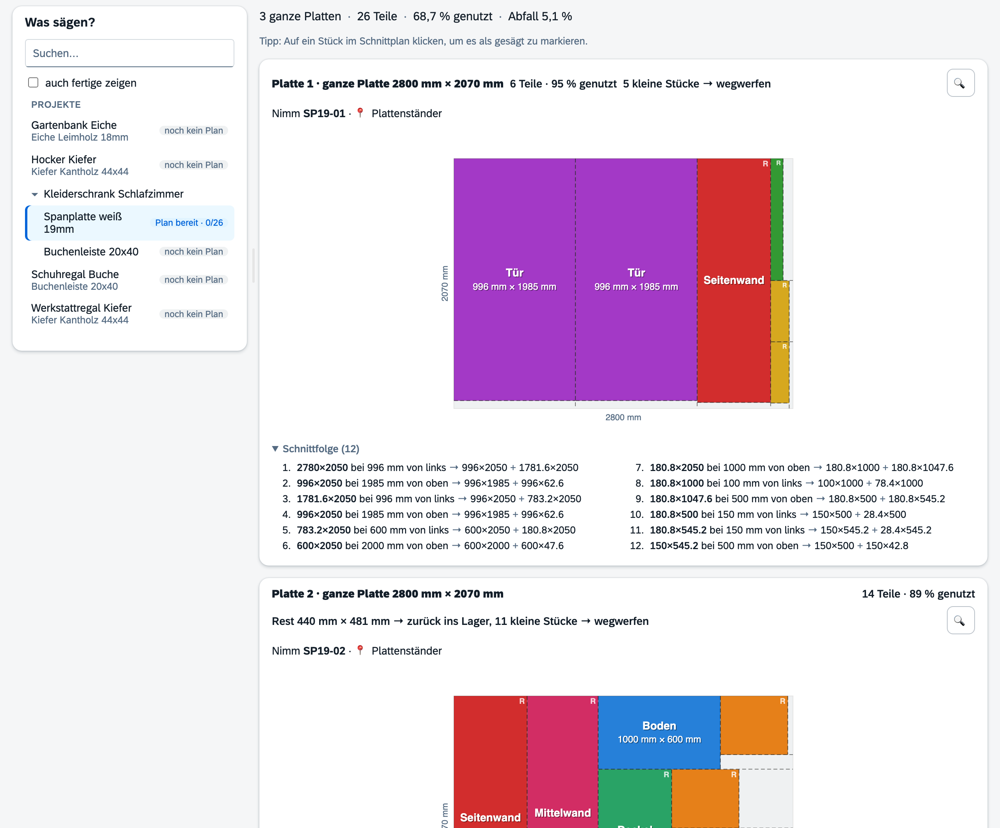
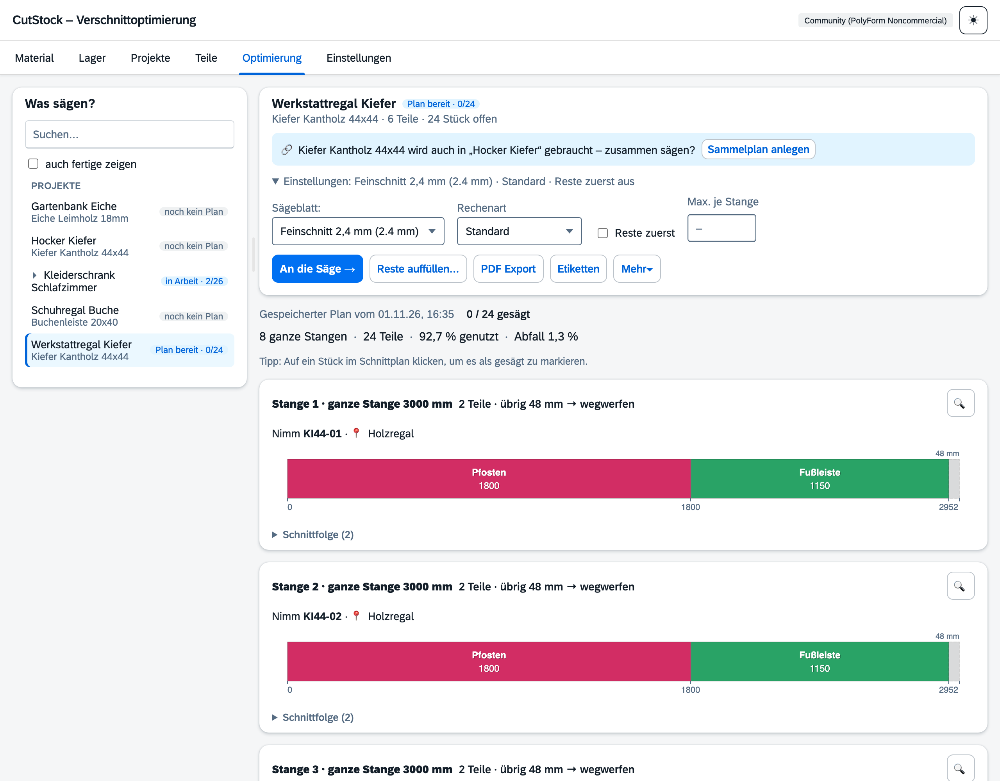

# CutStock

**Verschnitt minimieren. Jedes Brett, jede Stange, jede Platte optimal nutzen.**

CutStock ist ein Werkzeug zur Verschnittoptimierung, das Holzwerkern, Makern und kleinen Werkstaetten hilft, das Maximum aus ihrem Material herauszuholen. Ob Plattenteile fuer ein Regal oder Stangenprofile fuer einen Rahmen -- CutStock berechnet den optimalen Schnittplan, verwaltet den Lagerbestand und exportiert druckfertige Schnittplaene als PDF.

CutStock gibt es in zwei Varianten, die denselben Optimierungskern teilen:

- **Desktop-App** (macOS, Windows) -- Doppelklick, laeuft offline, Daten bleiben lokal (oeffnet die Web-UI im Standard-Browser)
- **Web-App** (Docker) -- selbst gehostet, erreichbar von jedem Browser oder Tablet im Netzwerk

Webseite und Handbuch: **[cutstock.app](https://cutstock.app/)** · [Handbuch](https://cutstock.app/handbuch/) · [REST-API](https://cutstock.app/api/)



> **[English version](README.md)**

## Funktionen

- **1D + 2D Optimierung** -- Stangen (1D Bin-Packing) und Platten (2D Guillotine-Packing) mit Saegeblatt-Schnittbreite (Kerf)
- **Drei Algorithmen** -- Schnell (Greedy), Nested Guillotine (intelligente Schnittrichtung), Gruendlich (Genetischer Algorithmus, ~95% Ausnutzung)
- **Maserungsrichtung** -- beruecksichtigt Holzmaserung pro Material und Teil (laengs, quer oder egal)
- **Besaeumung** -- konfigurierbarer Rand fuer beschaedigte Plattenkanten
- **Defekte markieren** -- Defektstellen (Astloecher, Risse, Verfaerbungen) pro Einzelstueck erfassen; der Optimierer umgeht sie automatisch
- **Stueck-Codes** -- jedes Stueck hat einen eindeutigen Code je Material (z. B. `AP40-07`, Kuerzel frei waehlbar); Etiketten je Stueck mit Code und Lagerort; frei gewordene Nummern werden nach einer einstellbaren Sperrfrist wieder vergeben
- **Lagerorte** -- eigener Reiter "Lager": feste Liste von Lagerorten, jedes Material liegt an einem Ort (Reste optional an einem eigenen), auf einen Blick sehen was wo liegt, Etiketten je Lagerort, Stuecke mit Grund entnehmen
- **Lagerverwaltung** -- Bestand verfolgen; beim Saegen wird genau das Stueck aus dem Plan ausgetragen, verwertbare Reste werden automatisch eingebucht und an den Reste-Lagerort gelegt; der groesste Rest behaelt den Code seines Bretts; jede Buchung landet im Lagerjournal
- **Abfallkiste** -- auf Wunsch werden Abschnitte unter dem Mindest-Restmass (ab einer Untergrenze) ohne Code in der Abfallkiste gefuehrt statt weggeworfen; Plan und PDF sagen bei jedem Abschnitt "ins Lager", "in die Abfallkiste" oder "wegwerfen"
- **Gespeicherte Schnittplaene** -- jede Berechnung wird gespeichert; beim Wechsel zwischen Projekten bleibt der Stand erhalten (was schon gesaegt ist). Neu berechnen behaelt angefangene Bretter, Hinweis wenn sich Teile oder Lager geaendert haben, "Projekt neu starten" zum erneuten Saegen
- **Lager-Reservierung** -- gespeicherte Plaene reservieren ihre noch nicht angefangenen Stuecke, andere Projekte verplanen sie nicht (abschaltbar); "Plan verwerfen" gibt sie frei
- **Reste zuerst** -- auf Wunsch erst nur Reste verplanen, dann ganze Stangen/Platten
- **Sammelplan** -- ein Material fuer mehrere Projekte gemeinsam optimieren (eigener Eintrag in der Arbeitsliste der Optimierung), mit Vergleich getrennt/gemeinsam; gesaegte Teile zaehlen direkt im jeweiligen Projekt
- **Fuellteile** -- Teile anderer Projekte mitsaegen, um den Abfall von Stangen und Platten aufzufuellen (ohne zusaetzliches Material); gesaegt zaehlen sie direkt beim eigenen Projekt, Ueberzaehliges kommt zu den Fertigteilen
- **Offene Teile und Saegeauftraege** -- Reiter "Teile" mit allem, was noch zu saegen ist, nach Material gruppiert mit Lager-Schaetzung; ausgewaehlte Teile mit "Jetzt saegen" als Saegeauftrag saegen oder in die Reste eines anderen Projekts mitnehmen; Fertigteile je Teil
- **Projektverwaltung** -- Teile nach Projekten organisieren, Projekt mehrfach bauen (Anzahl Exemplare), Import/Export als JSON, Teilelisten-Import aus CSV
- **Visuelle Schnittplaene** -- farbkodierte Zuschnittschemata mit Labels und Massen
- **Schnittfolge** -- nummerierte, massgenaue Schrittliste pro Schnittplan (Kerf eingerechnet, auch im PDF)
- **Werkstatt-Modus** -- Vollbild-Touch-Ansicht fuers Tablet an der Saege: welches Stueck wo liegt ("Nimm SP19-01 · Plattenstaender"), grosse Ziele, Fortschritt, Teile beim Saegen abhaken, entstehende Reste direkt beschriften und Etiketten drucken
- **Etiketten** -- druckbare Etiketten fuer Teile und Reste (A4-Boegen wie Avery 3475/L7160 oder Dymo/Brother-Etikettendrucker, freie Masse)
- **PDF-Export** -- kompaktes mehrseitiges Layout: Teileliste mit Anzahl, gleiche Schnittmuster zusammengefasst, Materialbedarf mit Stueck-Codes, Lagerort und Materialbild
- **Statistik** -- detaillierte Verschnittanalyse pro Lagerstueck und Gesamtwerte
- **Backup/Restore** -- komplette Datenbank + Einstellungen als ZIP; vor jedem Update legt CutStock automatisch eine Sicherung an
- **Update-Hinweis** -- CutStock prueft einmal am Tag, ob es eine neue Version gibt, und zeigt dann oben einen Knopf mit Schritt-fuer-Schritt-Anleitung (Synology, Unraid, Docker Compose bzw. Download der Desktop-App)
- **Mehrsprachig** -- Deutsch, English, Francais, Italiano
- **SAP Horizon Design** -- identischer Fiori-Look in Desktop und Web, helles und dunkles Farbschema
- **Tastenkuerzel** -- komplett per Tastatur bedienbar, in der Web-App frei belegbar
- **Plattformuebergreifend** -- macOS (.app), Windows (.exe), Docker
- **Materialbedarf** -- wenn der Lagerbestand nicht reicht, wird eine Einkaufsliste angezeigt; per Klick direkt ins Lager uebernehmen
- **REST-API** -- jede Funktion ist per API steuerbar (Automatisierung, Skripte, Scanner, Maschinen); Stuecke ueber ihren Code, Materialien ueber ihr Kuerzel; optional per API-Key (Bearer-Token) geschuetzt
- **iCloud-Sync** -- Desktop-Datenbank und Einstellungen synchronisieren automatisch zwischen Macs

## Web-App (Docker)

Die Web-App stellt denselben Optimierungskern ueber ein FastAPI-Backend mit
SAP-Fiori-Oberflaeche (Horizon) bereit. Alle Assets sind gebuendelt -- zur
Laufzeit ist keine Internetverbindung noetig.

### Schnellstart mit Docker Compose

```yaml
services:
  cutstock:
    image: ghcr.io/orohde/cutstock:latest
    container_name: cutstock
    restart: unless-stopped
    ports:
      - "8420:8000"
    volumes:
      - ./data:/data
    environment:
      - CUTSTOCK_DB=/data/cutstock.db
```

```bash
docker compose up -d
```

Danach `http://localhost:8420` im Browser oeffnen.

### Schnellstart mit docker run

```bash
docker run -d --name cutstock \
  -p 8420:8000 \
  -v "$(pwd)/data:/data" \
  ghcr.io/orohde/cutstock:latest
```

### Image selbst bauen

```bash
git clone https://github.com/orohde/CutStock.git
cd CutStock
docker build -t cutstock .
docker run -d -p 8420:8000 -v "$(pwd)/data:/data" cutstock
```

### Hinweise

| Thema | Detail |
|-------|--------|
| Port | Container lauscht auf `8000`; Host-Port frei waehlbar (`8420` in den Beispielen) |
| Daten | SQLite-Datenbank + `settings.json` liegen im `/data`-Volume |
| Unraid | Als Volume-Mapping `/mnt/user/appdata/cutstock:/data` verwenden |
| Synology | Im Container Manager den Ordner `data` neben der `compose.yml` vorher in der File Station anlegen -- sonst bricht der Start mit "Bind mount failed" ab |
| Updates | Image-Tag `latest` verwenden, dann zeigen Synology (Container Manager → Image → „Update verfuegbar“) und Unraid (Docker → „update ready“) neue Versionen von selbst an. CutStock weist ebenfalls darauf hin. Vor dem ersten Start einer neuen Version entsteht im Datenordner eine Kopie `cutstock-vor-update-<Datum>.db` (die letzten 5 bleiben liegen) |
| API-Key | Optional; unter Einstellungen setzen, um die REST-API vor externem Zugriff zu schuetzen. Die Web-Oberflaeche funktioniert ohne. |
| Reverse Proxy | Reines HTTP-Backend, laeuft hinter nginx, Traefik, Zoraxy, Caddy, ... |
| Benutzer | Bewusst Single-User -- keine eingebaute Anmeldung; bei Veroeffentlichung Reverse Proxy/SSO vorschalten |

Die Web-Oberflaeche umfasst Materialien, Lager, Projekte, Teile, Optimierung
mit visuellen Schnittplaenen, PDF-Export und Einstellungen. Die Tastenkuerzel
stehen auf der Einstellungen-Seite und lassen sich dort umbelegen (Taste
anklicken, neue Taste druecken).

## Handbuch

Das Handbuch ist nach den Reitern der Oberflaeche aufgeteilt: **[docs/handbuch](docs/handbuch/README.md)**

| Reiter | Inhalt |
|--------|--------|
| [Material](docs/handbuch/1-material.md) | Materialien, Lagerbestand je Material, Defekte, Etiketten |
| [Lager](docs/handbuch/2-lager.md) | Lagerorte, was liegt wo, Stuecke entnehmen, Abfallkiste, Lagerjournal |
| [Projekte](docs/handbuch/3-projekte.md) | Projekte und ihre Teile |
| [Teile](docs/handbuch/4-teile.md) | Offene Teile aller Projekte, Saegeauftraege, Fertigteile |
| [Optimierung](docs/handbuch/5-optimierung.md) | Schnittplaene, Fuellteile, Sammelplan, Werkstatt-Modus, PDF |
| [Einstellungen](docs/handbuch/6-einstellungen.md) | Sprache, Etiketten, Lager, REST-API, Backup, Saegeblaetter |
| [REST-API](docs/handbuch/api.md) | alle Endpoints, Lager-Befehle fuer Scanner und Maschinen |



## Algorithmen

CutStock loest das klassische [Cutting-Stock-Problem](https://de.wikipedia.org/wiki/Verschnittproblem) mit drei Ansaetzen:

### Warum Guillotine-Schnitte?

Alle CutStock-Algorithmen verwenden **Guillotine-Schnitte** -- jeder Schnitt geht vollstaendig von Kante zu Kante. Das ist eine bewusste Entscheidung:

| Ansatz | Materialausnutzung | Reste | Benoetigte Werkzeuge |
|--------|-------------------|-------|---------------------|
| **Guillotine** (CutStock) | ~85-95% | Immer rechteckig | Tischkreissaege, Handkreissaege |
| **Freischnitt** | ~93-98% | L-foermig, T-foermig | CNC-Fraese noetig |

Guillotine-Schnitte lassen sich mit jeder normalen Saege ausfuehren. Die Reste sind immer saubere Rechtecke, die gelagert und wiederverwendet werden koennen. Die 5-10% bessere Ausnutzung von Freischnitt-Algorithmen erfordert eine CNC-Fraese und erzeugt unregelmaessige Reste, die kaum wiederverwendbar sind -- fuer die meisten Werkstaetten unpraktisch.

### 1D -- Stangen / Profile

- **Schnell:** Schnittmuster per Column Generation, Auswahl per ganzzahliger Optimierung (ILP) mit minimalem Materialverbrauch; der Verschnitt wird moeglichst auf eine Reststange gebuendelt, mit wenigen unterschiedlichen Schnittmustern. Ergebnis in etwa einer Sekunde.
- **Gruendlich (GA):** Genetischer Algorithmus -- entwickelt 80 Permutationen ueber 200 Generationen, um bessere Kombinationen zu finden.

### 2D -- Platten

- **Schnell (Greedy):** Best-Area-Fit Guillotine-Packing. Teilt immer zuerst horizontal (rechts + unterhalb).
- **Nested Guillotine:** Wie Greedy, testet aber an jedem Schnitt **beide Teilungsrichtungen** (horizontal und vertikal) und waehlt die, die den groessten nutzbaren Rest erzeugt. Bessere Ergebnisse bei komplexen Layouts mit asymmetrischen Teilen.
- **Gruendlich (GA):** Genetischer Algorithmus -- optimiert Platzierungsreihenfolge und Rotationsentscheidungen ueber 200 Generationen. Beste Ergebnisse, braucht aber 2-5 Sekunden.

### Alle Algorithmen beruecksichtigen:

- **Saegeblatt-Schnittbreite** -- wird bei jedem Schnitt abgezogen
- **Besaeumung** -- beschaedigte Kanten werden vor dem Zuschnitt entfernt
- **Maserungsrichtung** -- Teile werden nur in Orientierungen platziert, die zur Holzmaserung passen
- **Endlicher Bestand** -- bevorzugt kleine Stuecke und Reste, meldet Teile, die nicht passen; mit "Reste zuerst" werden als Rest markierte Stuecke vorrangig verplant
- **Reservierung** -- von gespeicherten Plaenen anderer Projekte reservierte Stuecke werden nicht verplant
- **Defekte** -- Defektzonen werden umgangen, Stuecke mit Defekt im Plan einzeln gekennzeichnet
- **Materialbedarf** -- wenn Teile nicht passen, wird geschaetzt, wie viele zusaetzliche Bretter/Stangen benoetigt werden

## REST-API

Jede Funktion ist auch per REST-API unter `/api/` erreichbar, optional mit API-Key (Bearer-Token). Alle Endpoints und Beispiele: **[docs/handbuch/api.md](docs/handbuch/api.md)**. Eine ausprobierbare Beschreibung liefert CutStock selbst unter `/docs`.

## Download (Desktop)

Fertige Binaries fuer macOS und Windows gibt es auf der [Releases-Seite](https://github.com/orohde/CutStock/releases).

> **Wichtig: Unsignierte Builds**
>
> Die Releases sind **nicht code-signiert** (kein kostenpflichtiges Apple/Microsoft-Entwicklerzertifikat).
> Das Betriebssystem zeigt beim ersten Start eine Sicherheitswarnung:
>
> - **macOS**: Rechtsklick auf die App, "Oeffnen" waehlen, dann nochmal "Oeffnen" klicken (Gatekeeper)
> - **Windows**: "Weitere Informationen" klicken, dann "Trotzdem ausfuehren" (SmartScreen)
>
> Das ist bei kleiner, unabhaengiger Software normal. Der Quellcode ist vollstaendig einsehbar.
>
> Die Desktop-App oeffnet den Standard-Browser -- keine zusaetzlichen Laufzeitumgebungen noetig.

## Installation (aus dem Quellcode)

### Desktop

Voraussetzungen: Python 3.12+, macOS/Windows

```bash
git clone https://github.com/orohde/CutStock.git
cd CutStock
./setup.sh        # Erstellt venv, installiert Abhaengigkeiten
./run.sh          # Starten (Entwicklung)
```

Standalone-App bauen:

```bash
./build.sh          # macOS: erstellt dist/CutStock.app
build_windows.bat   # Windows: erstellt dist\CutStock\CutStock.exe
```

### Web (ohne Docker)

```bash
git clone https://github.com/orohde/CutStock.git
cd CutStock
python3 -m venv .venv && source .venv/bin/activate
pip install -r requirements-web.txt
CUTSTOCK_DB=./data/cutstock.db uvicorn web.app:app --host 0.0.0.0 --port 8000
```

## Datenspeicherung

| Variante | Datenbank | Einstellungen |
|----------|-----------|---------------|
| macOS | `iCloud Drive/CutStock/cutstock.db` | `iCloud Drive/CutStock/settings.json` |
| Windows | `%APPDATA%\CutStock\cutstock.db` | `%APPDATA%\CutStock\settings.json` |
| Docker | `/data/cutstock.db` (Volume) | `/data/settings.json` (Volume) |

Auf macOS synchronisieren Desktop-Datenbank und Einstellungen automatisch ueber iCloud Drive zwischen Macs. Ein Heartbeat-basierter Lock-Mechanismus verhindert gleichzeitigen Zugriff.

Beim ersten Start einer neuen Version (und bei jeder Datenbank-Erweiterung) legt CutStock vorher automatisch eine Kopie `cutstock-vor-update-<Datum>.db` neben der Datenbank an; die letzten 5 Kopien bleiben erhalten. Updates fuegen nur Tabellen und Spalten hinzu; aeltere Versionen koennen dieselbe Datenbank weiter oeffnen.

Desktop-App und Web-App teilen sich exakt dieselbe Oberflaeche: Der Desktop-Build
startet dasselbe FastAPI-Backend lokal und oeffnet es im Standard-Browser.
Es gibt kein separates "App-Fenster" -- was man auf macOS, Windows und Docker
sieht, ist dieselbe Web-UI. Eine Codebasis, ueberall identisch.

> **So funktioniert es**
>
> Beim Start von CutStock wird ein lokaler Webserver im Hintergrund gestartet
> und der Browser oeffnet sich automatisch unter `http://127.0.0.1:<Port>/`.
> Die App laeuft, bis man sie beendet:
>
> - **macOS**: CutStock ueber das Dock beenden (Rechtsklick -> Beenden) oder Cmd+Q
> - **Windows**: CutStock ueber den Task-Manager oder das System-Tray beenden
>
> Das Schliessen des Browser-Tabs stoppt den Server **nicht** -- man kann den
> Tab jederzeit wieder oeffnen oder die URL erneut aufrufen. Um CutStock
> vollstaendig zu stoppen, muss die App selbst beendet werden.
>
> Keine zusaetzlichen Laufzeitumgebungen oder Browser-Plugins erforderlich.

## Tech-Stack

- **Python 3.12+** -- Anwendungslogik
- **FastAPI + Uvicorn** -- Backend (Desktop lokal, Docker als Server)
- **SAP Fundamental Styles / Horizon Theme** -- Designsystem der UI (gebuendelt, Apache-2.0)
- **SQLite** -- lokale Datenbank (kein Server noetig)
- **reportlab** -- PDF-Erzeugung
- **PyInstaller** -- Standalone-App-Packaging
- **Docker** -- Container-Image fuer die Web-App

## Projektstruktur

```
CutStock/
  core/                    -- gemeinsam, GUI-unabhaengig
    db.py                  -- SQLite-Schema + Repository-Pattern
    models.py              -- Dataclasses (Material, Lager, Projekt, Teil, ...)
    optimize.py            -- 1D/2D-Optimierungsalgorithmen (Greedy + GA)
    pdf.py                 -- PDF-Export mit Schnittplan-Zeichnungen
    lock.py                -- iCloud-sicherer Heartbeat-Lock
    settings.py            -- JSON-basierte Einstellungen
  web/                     -- Anwendung (Backend + UI)
    app.py                 -- FastAPI-Backend (REST-API + statische Dateien)
    static/                -- Frontend (Vanilla JS/HTML/CSS)
      vendor/              -- gebuendelte Fundamental Styles + Horizon-Themes + Fonts
  ui/
    i18n.py                -- Uebersetzungen (DE/EN/FR/IT), auch vom Backend genutzt
  tests/                   -- Tests (Algorithmen, PDF, REST-API)
  tools/
    testdaten.py           -- umfangreiche Testdaten per REST in eine Test-Instanz
  desktop.py               -- Desktop-Einstiegspunkt (lokales FastAPI + Browser)
  desktop.spec             -- PyInstaller-Spec (macOS)
  desktop_win.spec         -- PyInstaller-Spec (Windows)
  Dockerfile               -- Container-Image der Web-App
  compose.yml              -- Docker-Compose-Beispiel
```

## Lizenz

**[PolyForm Noncommercial 1.0.0](LICENSE)** -- frei fuer jede nicht-kommerzielle Nutzung: privat, als Hobby, in Schulen, gemeinnuetzigen Vereinen und oeffentlichen Einrichtungen. Fuer diese Zwecke darf CutStock genutzt, veraendert und weitergegeben werden.

**Kommerzielle Nutzung:** Wer CutStock im Betrieb einsetzen moechte -- etwa in einer Schreinerei, Tischlerei oder einem anderen Gewerbe -- kann eine separate kommerzielle Lizenz erwerben. Anfragen bitte ueber [cutstock.app](https://cutstock.app/#download).

CutStock ist *source-available*: Der Quellcode ist offen einsehbar, aber kein Open Source im Sinne der OSI, weil kommerzielle Nutzung eine Lizenz erfordert. Versionen bis einschliesslich 2026.10.46 wurden unter CC BY-NC-SA 4.0 veroeffentlicht.

Gebuendelte Fremdbestandteile (u. a. SAP Fundamental Styles und Horizon-Theme-Assets in `web/static/vendor/`, Apache-2.0) stehen unter eigenen Lizenzen -- siehe [THIRD_PARTY_NOTICES.txt](THIRD_PARTY_NOTICES.txt).

## Mitmachen

Fehlermeldungen, Ideen und Uebersetzungsvorschlaege sind als [Issues](https://github.com/orohde/CutStock/issues/new/choose) willkommen. Code-Beitraege (Pull Requests) werden derzeit nicht angenommen -- siehe [CONTRIBUTING.md](CONTRIBUTING.md).
