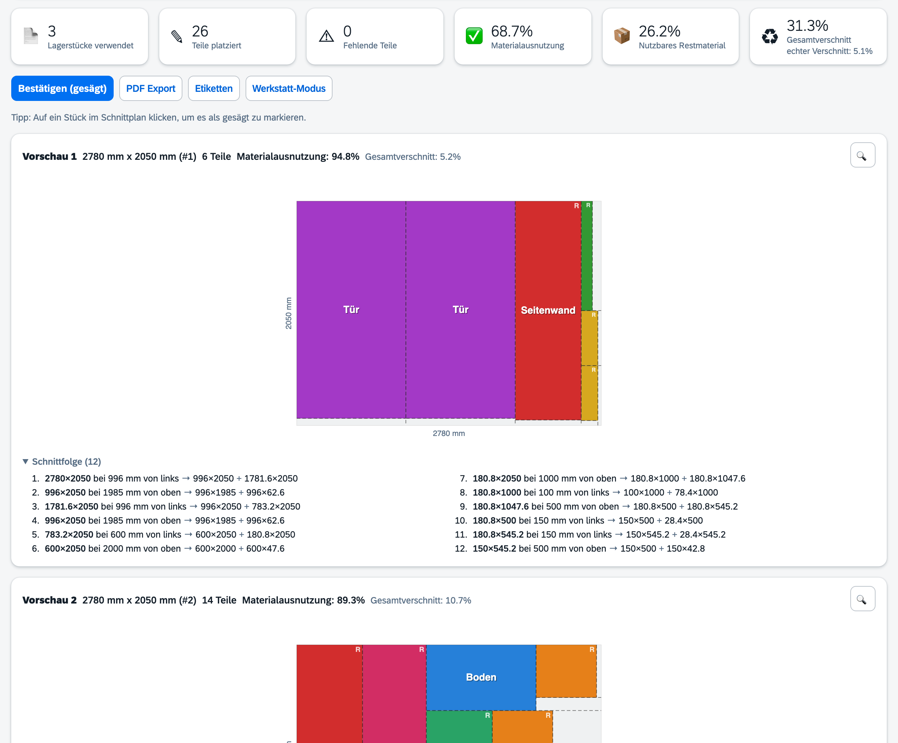
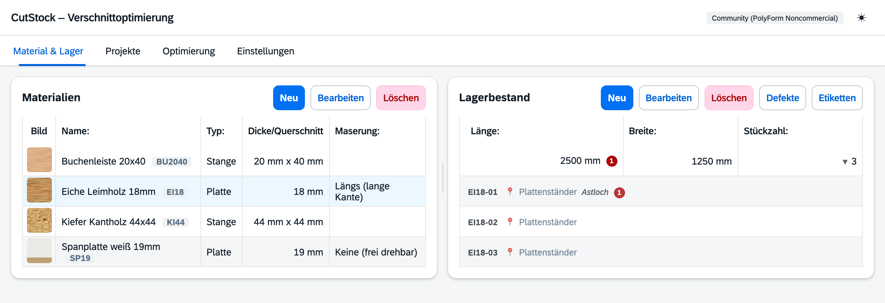
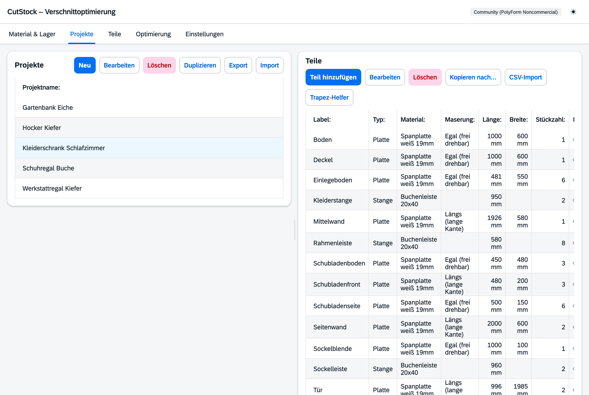
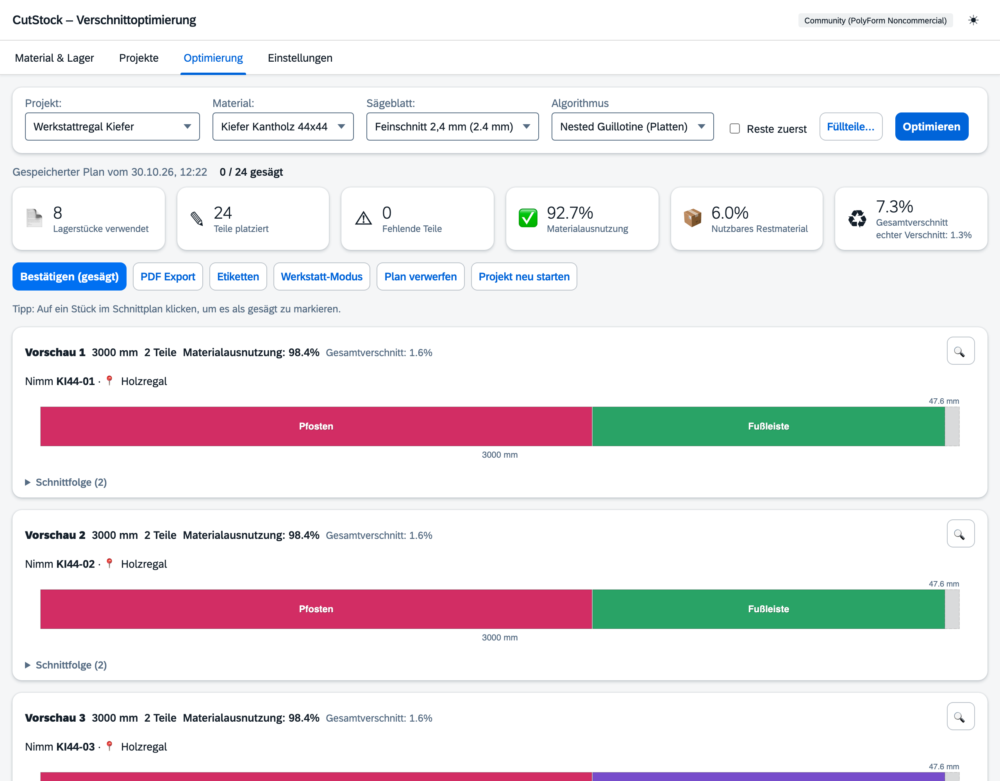
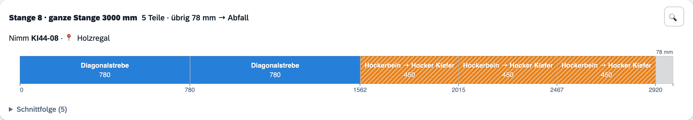
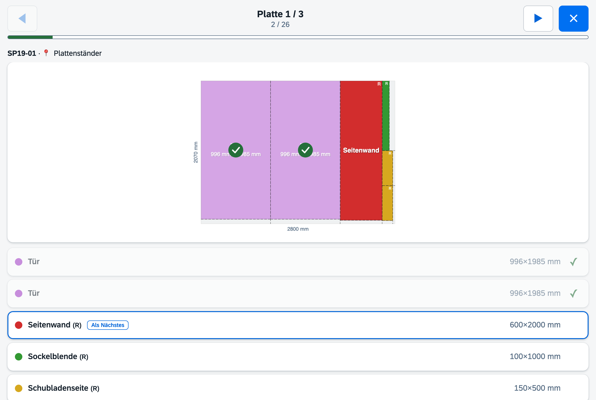
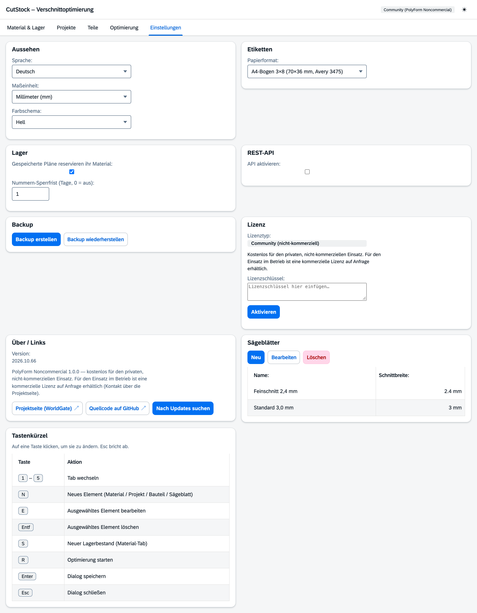

# CutStock

**Verschnitt minimieren. Jedes Brett, jede Stange, jede Platte optimal nutzen.**

CutStock ist ein Werkzeug zur Verschnittoptimierung, das Holzwerkern, Makern und kleinen Werkstaetten hilft, das Maximum aus ihrem Material herauszuholen. Ob Plattenteile fuer ein Regal oder Stangenprofile fuer einen Rahmen -- CutStock berechnet den optimalen Schnittplan, verwaltet den Lagerbestand und exportiert druckfertige Schnittplaene als PDF.

CutStock gibt es in zwei Varianten, die denselben Optimierungskern teilen:

- **Desktop-App** (macOS, Windows) -- Doppelklick, laeuft offline, Daten bleiben lokal (oeffnet die Web-UI im Standard-Browser)
- **Web-App** (Docker) -- selbst gehostet, erreichbar von jedem Browser oder Tablet im Netzwerk



> **[English version](README.md)**

## Funktionen

- **1D + 2D Optimierung** -- Stangen (1D Bin-Packing) und Platten (2D Guillotine-Packing) mit Saegeblatt-Schnittbreite (Kerf)
- **Drei Algorithmen** -- Schnell (Greedy), Nested Guillotine (intelligente Schnittrichtung), Gruendlich (Genetischer Algorithmus, ~95% Ausnutzung)
- **Maserungsrichtung** -- beruecksichtigt Holzmaserung pro Material und Teil (laengs, quer oder egal)
- **Besaeumung** -- konfigurierbarer Rand fuer beschaedigte Plattenkanten
- **Defekte markieren** -- Defektstellen (Astloecher, Risse, Verfaerbungen) pro Einzelstueck erfassen; der Optimierer umgeht sie automatisch
- **Stueck-Codes und Lagerorte** -- jedes Stueck hat einen eindeutigen Code je Material (z. B. `AP40-07`, Kuerzel frei waehlbar) und einen Lagerort (Regal, Restekiste, ...); Etiketten je Stueck mit Code und Lagerort; frei gewordene Nummern werden nach einer einstellbaren Sperrfrist wieder vergeben
- **Lagerverwaltung** -- Bestand verfolgen; beim Saegen wird genau das Stueck aus dem Plan ausgetragen, verwertbare Reste werden automatisch eingebucht, als Rest markiert und an den Reste-Lagerort gelegt; der groesste Rest behaelt den Code seines Bretts
- **Gespeicherte Schnittplaene** -- jede Berechnung wird gespeichert; beim Wechsel zwischen Projekten bleibt der Stand erhalten (was schon gesaegt ist). Neu berechnen behaelt angefangene Bretter, Hinweis wenn sich Teile oder Lager geaendert haben, "Projekt neu starten" zum erneuten Saegen
- **Lager-Reservierung** -- gespeicherte Plaene reservieren ihre noch nicht angefangenen Stuecke, andere Projekte verplanen sie nicht (abschaltbar); "Plan verwerfen" gibt sie frei
- **Reste zuerst** -- auf Wunsch erst nur Reste verplanen, dann ganze Stangen/Platten
- **Sammelplan** -- ein Material fuer mehrere Projekte gemeinsam optimieren ("Optimieren nach: Material"), mit Vergleich getrennt/gemeinsam; gesaegte Teile zaehlen direkt im jeweiligen Projekt
- **Fuellteile** -- Teile anderer Projekte mitsaegen, um den Abfall von Stangen und Platten aufzufuellen (ohne zusaetzliches Material); gesaegte Fuellteile kommen in den Teile-Vorrat ("Regal") und werden spaeter vom anderen Projekt uebernommen
- **Projektverwaltung** -- Teile nach Projekten organisieren, Projekt mehrfach bauen (Anzahl Exemplare), Import/Export als JSON, Teilelisten-Import aus CSV
- **Visuelle Schnittplaene** -- farbkodierte Zuschnittschemata mit Labels und Massen
- **Schnittfolge** -- nummerierte, massgenaue Schrittliste pro Schnittplan (Kerf eingerechnet, auch im PDF)
- **Werkstatt-Modus** -- Vollbild-Touch-Ansicht fuers Tablet an der Saege: welches Stueck wo liegt ("Nimm SP19-01 · Plattenstaender"), grosse Ziele, Fortschritt, Teile beim Saegen abhaken, entstehende Reste direkt beschriften und Etiketten drucken
- **Etiketten** -- druckbare Etiketten fuer Teile und Reste (A4-Boegen wie Avery 3475/L7160 oder Dymo/Brother-Etikettendrucker, freie Masse)
- **PDF-Export** -- kompaktes mehrseitiges Layout: Teileliste mit Anzahl, gleiche Schnittmuster zusammengefasst, Materialbedarf mit Stueck-Codes, Lagerort und Materialbild
- **Statistik** -- detaillierte Verschnittanalyse pro Lagerstueck und Gesamtwerte
- **Backup/Restore** -- komplette Datenbank + Einstellungen als ZIP; vor jedem Update legt CutStock automatisch eine Sicherung an
- **Update-Hinweis** -- CutStock prueft einmal am Tag, ob es eine neue Version gibt, und zeigt dann oben einen Knopf mit Schritt-fuer-Schritt-Anleitung (Synology, Unraid, Docker Compose bzw. Download der Desktop-App)
- **Mehrsprachig** -- Deutsch, English, Francais, Italiano
- **SAP Horizon Design** -- identischer Fiori-Look in Desktop und Web, helles und dunkles Farbschema
- **Tastenkuerzel** -- komplett per Tastatur bedienbar, in der Web-App frei belegbar
- **Plattformuebergreifend** -- macOS (.app), Windows (.exe), Docker
- **Materialbedarf** -- wenn der Lagerbestand nicht reicht, wird eine Einkaufsliste angezeigt; per Klick direkt ins Lager uebernehmen
- **REST-API** -- vollstaendige API fuer externen Zugriff (Automatisierung, Skripte, Integrationen); optional per API-Key (Bearer-Token) geschuetzt
- **iCloud-Sync** -- Desktop-Datenbank und Einstellungen synchronisieren automatisch zwischen Macs

## Web-App (Docker)

Die Web-App stellt denselben Optimierungskern ueber ein FastAPI-Backend mit
SAP-Fiori-Oberflaeche (Horizon) bereit. Alle Assets sind gebuendelt -- zur
Laufzeit ist keine Internetverbindung noetig.

### Schnellstart mit Docker Compose

```yaml
services:
  cutstock:
    image: ghcr.io/orohde/cutstock:latest
    container_name: cutstock
    restart: unless-stopped
    ports:
      - "8420:8000"
    volumes:
      - ./data:/data
    environment:
      - CUTSTOCK_DB=/data/cutstock.db
```

```bash
docker compose up -d
```

Danach `http://localhost:8420` im Browser oeffnen.

### Schnellstart mit docker run

```bash
docker run -d --name cutstock \
  -p 8420:8000 \
  -v "$(pwd)/data:/data" \
  ghcr.io/orohde/cutstock:latest
```

### Image selbst bauen

```bash
git clone https://github.com/orohde/CutStock.git
cd CutStock
docker build -t cutstock .
docker run -d -p 8420:8000 -v "$(pwd)/data:/data" cutstock
```

### Hinweise

| Thema | Detail |
|-------|--------|
| Port | Container lauscht auf `8000`; Host-Port frei waehlbar (`8420` in den Beispielen) |
| Daten | SQLite-Datenbank + `settings.json` liegen im `/data`-Volume |
| Unraid | Als Volume-Mapping `/mnt/user/appdata/cutstock:/data` verwenden |
| Synology | Im Container Manager den Ordner `data` neben der `compose.yml` vorher in der File Station anlegen -- sonst bricht der Start mit "Bind mount failed" ab |
| Updates | Image-Tag `latest` verwenden, dann zeigen Synology (Container Manager → Image → „Update verfuegbar“) und Unraid (Docker → „update ready“) neue Versionen von selbst an. CutStock weist ebenfalls darauf hin. Vor dem ersten Start einer neuen Version entsteht im Datenordner eine Kopie `cutstock-vor-update-<Datum>.db` (die letzten 5 bleiben liegen) |
| API-Key | Optional; unter Einstellungen setzen, um die REST-API vor externem Zugriff zu schuetzen. Die Web-Oberflaeche funktioniert ohne. |
| Reverse Proxy | Reines HTTP-Backend, laeuft hinter nginx, Traefik, Zoraxy, Caddy, ... |
| Benutzer | Bewusst Single-User -- keine eingebaute Anmeldung; bei Veroeffentlichung Reverse Proxy/SSO vorschalten |

Die Web-Oberflaeche umfasst Materialien, Lager, Projekte, Teile, Optimierung
mit visuellen Schnittplaenen, PDF-Export und Einstellungen. Die Tastenkuerzel
stehen auf der Einstellungen-Seite und lassen sich dort umbelegen (Taste
anklicken, neue Taste druecken).

## Screenshots

### Material & Lager

Materialien (Platten, Stangen) mit Dicke, Querschnitt, Maserungsrichtung, Besaeumung, Rest-Schwellen, Kuerzel und Lagerort verwalten. Der Lagerbestand zeigt die Stuecke des gewaehlten Materials -- aufklappbar mit Stueck-Code, Lagerort, Notiz und Defekt-Badges. Reste sind markiert, reservierte Stuecke zeigen das Projekt, fuer das sie verplant sind. Doppelklick auf ein Stueck aendert Notiz und Lagerort.



### Projekte

Teile nach Projekten organisieren. Jedes Teil hat ein Label, Typ, Material, Masse, Stueckzahl und Maserungsrichtung. Wird ein Projekt mehrfach gebaut, genuegt die Anzahl Exemplare am Projekt -- alle Exemplare werden gemeinsam optimiert. Projekte als JSON importieren/exportieren.



### Optimierung -- Stangen

Projekt, Material, Saegeblatt und Algorithmus waehlen. Der Optimierer berechnet den besten Schnittplan, speichert ihn und zeigt farbkodierte Zuschnittschemata mit Statistik. Ueber jedem Brett steht, welches Stueck man nehmen soll und wo es liegt. Optional "Reste zuerst" aufbrauchen.



### Fuellteile

Bleibt am Ende einer Stange oder auf einer Platte Abfall, kann CutStock ihn mit Teilen aus anderen Projekten auffuellen ("Fuellteile..."). Es wird nie mehr Material verbraucht; standardmaessig wird nur Abfall unter dem Mindest-Restmass belegt, per Haekchen auch verwertbare Reste. Die Fuellteile sind schraffiert (auch im PDF, dort mit eigenem Abschnitt in der Stueckliste) und tragen ihr Herkunftsprojekt. Gesaegt kommen sie in den Teile-Vorrat und werden beim anderen Projekt mit einem Klick uebernommen. Fuellteile lassen sich auch im Reiter "Teile" auswaehlen ("Als Fuellteile...").



### Sammelplan

Wird dasselbe Material in mehreren Projekten gebraucht, kann man es gemeinsam optimieren: Im Optimierungs-Tab "Optimieren nach: Material (Sammelplan)" waehlen, Material auswaehlen und die Projekte anhaken. "Vergleichen" zeigt, wie viel Material das gegenueber getrennten Plaenen spart. Im Plan steht bei jedem Teil sein Projekt ("Seite → Regal"); abgehakte Teile zaehlen als Fortschritt dieses Projekts. Nicht angefangene Einzelplaene der Projekte werden ersetzt; Teile, die ungesaegt in einem angefangenen Plan liegen, bleiben dort. Jedes Projekt bekommt im Plan eine eigene Farbe (Legende mit Stueckzahl in der Statistik), das PDF listet die Teile nach Projekt gruppiert, und im Projekte-Tab markiert ein Hinweis "Sammelplan" die beteiligten Projekte.

### Teile und Schnittlisten

Der Reiter "Teile" zeigt die Teile aller Projekte, filterbar nach Material und Projekt, mit offener Stueckzahl und Regal-Vorrat. Teile anhaken, Menge eintragen und "Schnittliste erstellen": Es entsteht eine Schnittliste, die im Projekte-Tab erscheint und wie ein Projekt optimiert, gesaegt und gedruckt wird. Abgehakte Teile kommen ins Regal (Vorrat) ihres Herkunftsprojekts, das sie spaeter per Klick uebernimmt. Ist alles gesaegt, bietet CutStock an, die Liste zu loeschen. Beim Duplizieren bleibt eine Schnittliste eine Schnittliste.

Die Kopfzeile jedes Plans sagt, was man in der Hand hat: "Stange 2 · Rest 960 mm" bzw. "Platte 1 · ganze Platte 2800 × 2070 mm", wie viele Teile darauf liegen und was uebrig bleibt (zurueck ins Lager oder Abfall). In der Zeichnung steht bei jedem Teil sein Name und seine Masse.

### Optimierung -- Platten

2D Guillotine-Packing fuer Plattenwerkstoffe. Alle Schnitte gehen von Kante zu Kante, so dass alle Reste Rechtecke bleiben und wiederverwendbar sind. Die nummerierte Schnittfolge unter jedem Plan sagt exakt, wo gesaegt wird -- die Saegeblattbreite ist bereits eingerechnet.


### Werkstatt-Modus

Vollbild-Ansicht fuers Tablet neben der Saege: eine Platte pro Seite mit Stueck-Code und Lagerort, grosse Touch-Ziele, Gesamtfortschritt und "Als Naechstes"-Markierung. Abhaken aktualisiert Teile-Fortschritt und Lager live; entstehende Reste werden mit ihrem neuen Code angezeigt und koennen gleich als Etikett gedruckt werden.



### Einstellungen

Sprache, Farbschema (Horizon hell/dunkel), Masseinheit (mm/cm), Etiketten-Papierformat (A4-Boegen oder Etikettendrucker), Lager (Reservierung, Nummern-Sperrfrist), Saegeblaetter, Tastenkuerzel und Backup/Restore konfigurieren.



## Algorithmen

CutStock loest das klassische [Cutting-Stock-Problem](https://de.wikipedia.org/wiki/Verschnittproblem) mit drei Ansaetzen:

### Warum Guillotine-Schnitte?

Alle CutStock-Algorithmen verwenden **Guillotine-Schnitte** -- jeder Schnitt geht vollstaendig von Kante zu Kante. Das ist eine bewusste Entscheidung:

| Ansatz | Materialausnutzung | Reste | Benoetigte Werkzeuge |
|--------|-------------------|-------|---------------------|
| **Guillotine** (CutStock) | ~85-95% | Immer rechteckig | Tischkreissaege, Handkreissaege |
| **Freischnitt** | ~93-98% | L-foermig, T-foermig | CNC-Fraese noetig |

Guillotine-Schnitte lassen sich mit jeder normalen Saege ausfuehren. Die Reste sind immer saubere Rechtecke, die gelagert und wiederverwendet werden koennen. Die 5-10% bessere Ausnutzung von Freischnitt-Algorithmen erfordert eine CNC-Fraese und erzeugt unregelmaessige Reste, die kaum wiederverwendbar sind -- fuer die meisten Werkstaetten unpraktisch.

### 1D -- Stangen / Profile

- **Schnell:** Schnittmuster per Column Generation, Auswahl per ganzzahliger Optimierung (ILP) mit minimalem Materialverbrauch; der Verschnitt wird moeglichst auf eine Reststange gebuendelt, mit wenigen unterschiedlichen Schnittmustern. Ergebnis in etwa einer Sekunde.
- **Gruendlich (GA):** Genetischer Algorithmus -- entwickelt 80 Permutationen ueber 200 Generationen, um bessere Kombinationen zu finden.

### 2D -- Platten

- **Schnell (Greedy):** Best-Area-Fit Guillotine-Packing. Teilt immer zuerst horizontal (rechts + unterhalb).
- **Nested Guillotine:** Wie Greedy, testet aber an jedem Schnitt **beide Teilungsrichtungen** (horizontal und vertikal) und waehlt die, die den groessten nutzbaren Rest erzeugt. Bessere Ergebnisse bei komplexen Layouts mit asymmetrischen Teilen.
- **Gruendlich (GA):** Genetischer Algorithmus -- optimiert Platzierungsreihenfolge und Rotationsentscheidungen ueber 200 Generationen. Beste Ergebnisse, braucht aber 2-5 Sekunden.

### Alle Algorithmen beruecksichtigen:

- **Saegeblatt-Schnittbreite** -- wird bei jedem Schnitt abgezogen
- **Besaeumung** -- beschaedigte Kanten werden vor dem Zuschnitt entfernt
- **Maserungsrichtung** -- Teile werden nur in Orientierungen platziert, die zur Holzmaserung passen
- **Endlicher Bestand** -- bevorzugt kleine Stuecke und Reste, meldet Teile, die nicht passen; mit "Reste zuerst" werden als Rest markierte Stuecke vorrangig verplant
- **Reservierung** -- von gespeicherten Plaenen anderer Projekte reservierte Stuecke werden nicht verplant
- **Defekte** -- Defektzonen werden umgangen, Stuecke mit Defekt im Plan einzeln gekennzeichnet
- **Materialbedarf** -- wenn Teile nicht passen, wird geschaetzt, wie viele zusaetzliche Bretter/Stangen benoetigt werden

## REST-API

Die Web-App stellt eine vollstaendige REST-API unter `/api/` bereit. Alle Endpoints akzeptieren und liefern JSON.

### Authentifizierung

Wenn ein API-Key konfiguriert ist (Einstellungen-Seite), muessen externe Anfragen ihn als Bearer-Token mitschicken:

```bash
curl -H "Authorization: Bearer DEIN_API_KEY" http://cutstock:8420/api/materials
```

Anfragen von der eigenen Web-Oberflaeche (Same-Origin) und von localhost sind immer ohne Key erlaubt.

### Endpoints

| Methode | Pfad | Beschreibung |
|---------|------|-------------|
| **Materialien** | | |
| GET | `/api/materials` | Alle Materialien auflisten |
| POST | `/api/materials` | Material anlegen |
| PUT | `/api/materials/{id}` | Material aktualisieren |
| DELETE | `/api/materials/{id}` | Material loeschen |
| **Lagerbestand** | | |
| GET | `/api/stock?material_id=N` | Lagerbestand auflisten (optionaler Filter) |
| POST | `/api/stock` | Lagereintrag anlegen |
| PUT | `/api/stock/{id}` | Lagereintrag aktualisieren |
| DELETE | `/api/stock/{id}` | Lagereintrag loeschen |
| GET | `/api/stock/{id}/pieces` | Einzelstuecke auflisten (Code, Lagerort, reserviert fuer) |
| PUT | `/api/pieces/{id}` | Einzelstueck aktualisieren (Notiz, Lagerort) |
| GET/POST/DELETE | `/api/materials/{id}/image` | Materialbild lesen, hochladen, entfernen |
| **Defekte** | | |
| GET | `/api/stock/{id}/defects` | Defekte eines Lagerstuecks |
| GET | `/api/pieces/{id}/defects` | Defekte eines Einzelstuecks |
| POST | `/api/pieces/{id}/defects` | Defekt hinzufuegen |
| PUT | `/api/defects/{id}` | Defekt aktualisieren |
| DELETE | `/api/defects/{id}` | Defekt loeschen |
| **Saegeblaetter** | | |
| GET | `/api/blades` | Saegeblaetter auflisten |
| POST | `/api/blades` | Saegeblatt anlegen |
| PUT | `/api/blades/{id}` | Saegeblatt aktualisieren |
| DELETE | `/api/blades/{id}` | Saegeblatt loeschen |
| **Projekte** | | |
| GET | `/api/projects` | Projekte auflisten |
| GET | `/api/projects/{id}` | Projekt abrufen |
| POST | `/api/projects` | Projekt anlegen |
| PUT | `/api/projects/{id}` | Projekt aktualisieren (Name, Anzahl Exemplare) |
| DELETE | `/api/projects/{id}` | Projekt loeschen |
| POST | `/api/projects/{id}/clone` | Projekt kopieren |
| POST | `/api/projects/{id}/copy-parts` | Teile in ein Projekt kopieren |
| POST | `/api/projects/{id}/restart` | Projekt neu starten (Fortschritt 0, Plaene weg, Lager bleibt) |
| **Teile** | | |
| GET | `/api/projects/{id}/parts` | Teile eines Projekts auflisten |
| POST | `/api/projects/{id}/parts` | Teil hinzufuegen |
| PUT | `/api/parts/{id}` | Teil aktualisieren |
| DELETE | `/api/parts/{id}` | Teil loeschen |
| **Optimierung und Plaene** | | |
| POST | `/api/optimize` | Optimieren und als Plan des Projekts fuer das Material speichern |
| GET | `/api/projects/{id}/plans/{material_id}` | Gespeicherten Plan abrufen (`null`, wenn keiner existiert) |
| POST | `/api/plan-pieces/{id}` | Stueck als gesaegt markieren/zuruecknehmen (`{"gesaegt": true}`), aktualisiert Fortschritt und Lager |
| POST | `/api/plans/{id}/confirm-all` | Alle offenen Stuecke des Plans als gesaegt markieren |
| DELETE | `/api/plans/{id}` | Plan verwerfen (gibt reservierte Stuecke frei) |
| GET | `/api/projects/{id}/fill-candidates/{material_id}` | Moegliche Fuellteile aus anderen Projekten |
| GET | `/api/sammel/{material_id}` | Sammelplan-Status und moegliche Projekte |
| POST | `/api/sammel/optimize` | Sammelplan anlegen/ersetzen und berechnen |
| GET | `/api/parts` | Teile aller Projekte (Reiter "Teile") |
| POST | `/api/cut-lists` | Schnittliste aus einzelnen Teilen anlegen |
| POST | `/api/sammel/compare` | Vergleich getrennt/gemeinsam (ohne Speichern) |
| POST | `/api/projects/{id}/take-stock/{material_id}` | Teile-Vorrat ("Regal") als gesaegt uebernehmen |
| **Export** | | |
| POST | `/api/pdf` | PDF-Schnittplan erzeugen |
| POST | `/api/labels` | Etiketten-PDF erzeugen |
| **System** | | |
| GET | `/api/version` | App-Version und Links |
| GET | `/api/license` | Lizenzstatus |
| GET | `/api/settings` | Einstellungen lesen |
| PUT | `/api/settings` | Einstellungen aendern |
| GET | `/api/backup` | Datenbank-Backup herunterladen (ZIP) |
| POST | `/api/restore` | Aus Backup wiederherstellen (ZIP) |
| GET | `/api/i18n/{lang}` | Uebersetzungen fuer eine Sprache |

### Optimierungsanfrage

```json
POST /api/optimize
{
  "project_id": 1,
  "material_id": 3,
  "blade_id": 1,
  "algorithm": "nested",
  "reste_zuerst": false,
  "fuellteile": [{"teil_id": 42, "modus": "auffuellen", "menge": 0}],
  "fuell_alle_reste": false
}
```

Algorithmus-Optionen: `greedy`, `nested`, `ga`. `reste_zuerst`, `fuellteile` und `fuell_alle_reste` sind optional (Fuellteil-Modus `auffuellen` oder `fest`; ohne `fuellteile` bleibt die Auswahl des gespeicherten Plans).

Die Antwort ist der gespeicherte Plan: `plan_id`, `schnittplaene` (je Brett u. a. `stueck_code`, `lagerort`, `platzierungen` mit `id` und `gesaegt`), `fehlende_teile`, `gesamt_verschnitt_prozent`, `materialbedarf` (zusaetzlich benoetigtes Material -- leer wenn alles passt) sowie Hinweise `veraltet` und `lager_fehlt`.

## Download (Desktop)

Fertige Binaries fuer macOS und Windows gibt es auf der [Releases-Seite](https://github.com/orohde/CutStock/releases).

> **Wichtig: Unsignierte Builds**
>
> Die Releases sind **nicht code-signiert** (kein kostenpflichtiges Apple/Microsoft-Entwicklerzertifikat).
> Das Betriebssystem zeigt beim ersten Start eine Sicherheitswarnung:
>
> - **macOS**: Rechtsklick auf die App, "Oeffnen" waehlen, dann nochmal "Oeffnen" klicken (Gatekeeper)
> - **Windows**: "Weitere Informationen" klicken, dann "Trotzdem ausfuehren" (SmartScreen)
>
> Das ist bei kleiner, unabhaengiger Software normal. Der Quellcode ist vollstaendig einsehbar.
>
> Die Desktop-App oeffnet den Standard-Browser -- keine zusaetzlichen Laufzeitumgebungen noetig.

## Installation (aus dem Quellcode)

### Desktop

Voraussetzungen: Python 3.12+, macOS/Windows

```bash
git clone https://github.com/orohde/CutStock.git
cd CutStock
./setup.sh        # Erstellt venv, installiert Abhaengigkeiten
./run.sh          # Starten (Entwicklung)
```

Standalone-App bauen:

```bash
./build.sh          # macOS: erstellt dist/CutStock.app
build_windows.bat   # Windows: erstellt dist\CutStock\CutStock.exe
```

### Web (ohne Docker)

```bash
git clone https://github.com/orohde/CutStock.git
cd CutStock
python3 -m venv .venv && source .venv/bin/activate
pip install -r requirements-web.txt
CUTSTOCK_DB=./data/cutstock.db uvicorn web.app:app --host 0.0.0.0 --port 8000
```

## Datenspeicherung

| Variante | Datenbank | Einstellungen |
|----------|-----------|---------------|
| macOS | `iCloud Drive/CutStock/cutstock.db` | `iCloud Drive/CutStock/settings.json` |
| Windows | `%APPDATA%\CutStock\cutstock.db` | `%APPDATA%\CutStock\settings.json` |
| Docker | `/data/cutstock.db` (Volume) | `/data/settings.json` (Volume) |

Auf macOS synchronisieren Desktop-Datenbank und Einstellungen automatisch ueber iCloud Drive zwischen Macs. Ein Heartbeat-basierter Lock-Mechanismus verhindert gleichzeitigen Zugriff.

Beim ersten Start einer neuen Version (und bei jeder Datenbank-Erweiterung) legt CutStock vorher automatisch eine Kopie `cutstock-vor-update-<Datum>.db` neben der Datenbank an; die letzten 5 Kopien bleiben erhalten. Updates fuegen nur Tabellen und Spalten hinzu; aeltere Versionen koennen dieselbe Datenbank weiter oeffnen.

Desktop-App und Web-App teilen sich exakt dieselbe Oberflaeche: Der Desktop-Build
startet dasselbe FastAPI-Backend lokal und oeffnet es im Standard-Browser.
Es gibt kein separates "App-Fenster" -- was man auf macOS, Windows und Docker
sieht, ist dieselbe Web-UI. Eine Codebasis, ueberall identisch.

> **So funktioniert es**
>
> Beim Start von CutStock wird ein lokaler Webserver im Hintergrund gestartet
> und der Browser oeffnet sich automatisch unter `http://127.0.0.1:<Port>/`.
> Die App laeuft, bis man sie beendet:
>
> - **macOS**: CutStock ueber das Dock beenden (Rechtsklick -> Beenden) oder Cmd+Q
> - **Windows**: CutStock ueber den Task-Manager oder das System-Tray beenden
>
> Das Schliessen des Browser-Tabs stoppt den Server **nicht** -- man kann den
> Tab jederzeit wieder oeffnen oder die URL erneut aufrufen. Um CutStock
> vollstaendig zu stoppen, muss die App selbst beendet werden.
>
> Keine zusaetzlichen Laufzeitumgebungen oder Browser-Plugins erforderlich.

## Tech-Stack

- **Python 3.12+** -- Anwendungslogik
- **FastAPI + Uvicorn** -- Backend (Desktop lokal, Docker als Server)
- **SAP Fundamental Styles / Horizon Theme** -- Designsystem der UI (gebuendelt, Apache-2.0)
- **SQLite** -- lokale Datenbank (kein Server noetig)
- **reportlab** -- PDF-Erzeugung
- **PyInstaller** -- Standalone-App-Packaging
- **Docker** -- Container-Image fuer die Web-App

## Projektstruktur

```
CutStock/
  core/                    -- gemeinsam, GUI-unabhaengig
    db.py                  -- SQLite-Schema + Repository-Pattern
    models.py              -- Dataclasses (Material, Lager, Projekt, Teil, ...)
    optimize.py            -- 1D/2D-Optimierungsalgorithmen (Greedy + GA)
    pdf.py                 -- PDF-Export mit Schnittplan-Zeichnungen
    lock.py                -- iCloud-sicherer Heartbeat-Lock
    settings.py            -- JSON-basierte Einstellungen
  web/                     -- Anwendung (Backend + UI)
    app.py                 -- FastAPI-Backend (REST-API + statische Dateien)
    static/                -- Frontend (Vanilla JS/HTML/CSS)
      vendor/              -- gebuendelte Fundamental Styles + Horizon-Themes + Fonts
  ui/
    i18n.py                -- Uebersetzungen (DE/EN/FR/IT), auch vom Backend genutzt
  tests/                   -- Tests (Algorithmen, PDF, REST-API)
  tools/
    testdaten.py           -- umfangreiche Testdaten per REST in eine Test-Instanz
  desktop.py               -- Desktop-Einstiegspunkt (lokales FastAPI + Browser)
  desktop.spec             -- PyInstaller-Spec (macOS)
  desktop_win.spec         -- PyInstaller-Spec (Windows)
  Dockerfile               -- Container-Image der Web-App
  compose.yml              -- Docker-Compose-Beispiel
```

## Lizenz

**[PolyForm Noncommercial 1.0.0](LICENSE)** -- frei fuer jede nicht-kommerzielle Nutzung: privat, als Hobby, in Schulen, gemeinnuetzigen Vereinen und oeffentlichen Einrichtungen. Fuer diese Zwecke darf CutStock genutzt, veraendert und weitergegeben werden.

**Kommerzielle Nutzung:** Wer CutStock im Betrieb einsetzen moechte -- etwa in einer Schreinerei, Tischlerei oder einem anderen Gewerbe -- kann eine separate kommerzielle Lizenz erwerben. Anfragen bitte ueber das Kontaktformular auf [worldgate.de/cutstock](https://worldgate.de/cutstock/).

CutStock ist *source-available*: Der Quellcode ist offen einsehbar, aber kein Open Source im Sinne der OSI, weil kommerzielle Nutzung eine Lizenz erfordert. Versionen bis einschliesslich 2026.10.46 wurden unter CC BY-NC-SA 4.0 veroeffentlicht.

Gebuendelte Fremdbestandteile (u. a. SAP Fundamental Styles und Horizon-Theme-Assets in `web/static/vendor/`, Apache-2.0) stehen unter eigenen Lizenzen -- siehe [THIRD_PARTY_NOTICES.txt](THIRD_PARTY_NOTICES.txt).

## Mitmachen

Fehlermeldungen, Ideen und Uebersetzungsvorschlaege sind als [Issues](https://github.com/orohde/CutStock/issues/new/choose) willkommen. Code-Beitraege (Pull Requests) werden derzeit nicht angenommen -- siehe [CONTRIBUTING.md](CONTRIBUTING.md).
