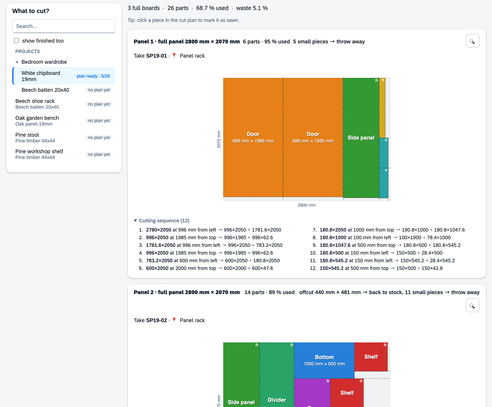
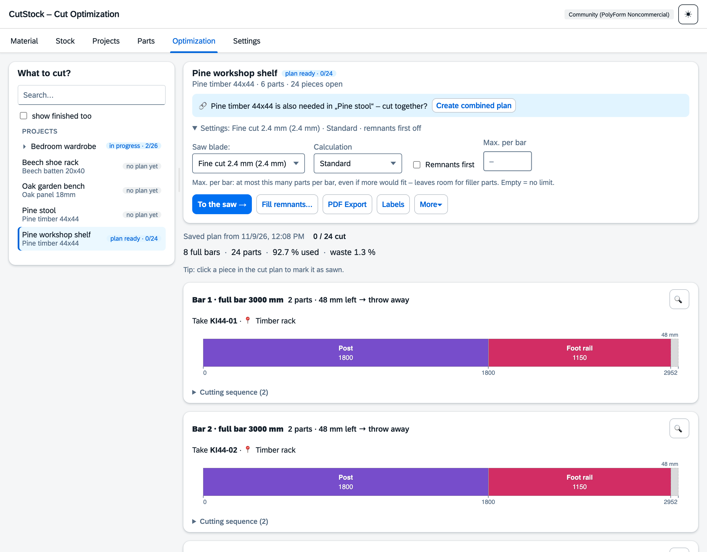

# CutStock

**Minimize waste. Maximize every board, bar, and panel.**

CutStock is a cut optimization tool (Verschnittoptimierung) that helps woodworkers, makers, and small workshops get the most out of their material. Whether you're cutting panels for a bookshelf or bars for a frame -- CutStock calculates the optimal cutting layout, tracks your stock, and exports print-ready cut plans as PDF.

CutStock comes in two flavors that share the same optimization core:

- **Desktop app** (macOS, Windows) -- double-click, works offline, data stays local (opens the web UI in your default browser)
- **Web app** (Docker) -- self-hosted, reachable from any browser or tablet in your network



> **[Deutsche Version](README.de.md)**

## Features

- **1D + 2D Optimization** -- bars (1D bin-packing) and panels (2D guillotine packing) with saw blade kerf
- **Three Algorithms** -- Fast (Greedy), Nested Guillotine (smart split direction), Thorough (Genetic Algorithm, ~95% utilization)
- **Grain Direction** -- respects wood grain per material and part (lengthwise, crosswise, or any)
- **Edge Trimming** -- configurable trim margin for damaged board edges
- **Defect Marking** -- mark defects (knots, cracks, discolorations) per individual piece; the optimizer routes cuts around them automatically
- **Piece Codes** -- every piece has a unique code per material (e.g. `AP40-07`, short code of your choice); labels per piece with code and location; freed numbers are reused after a configurable lock period
- **Storage Locations** -- own "Stock" tab: fixed list of locations, every material lives at one location (offcuts optionally at their own), see at a glance what is where, labels per location, take pieces out with a reason
- **Stock Management** -- track inventory; when sawing, exactly the piece from the plan is deducted, usable remnants are added automatically and placed in the remnant location; the largest remnant keeps its board's code; every booking goes into the stock journal
- **Offcut Bin** -- optionally, offcuts below the minimum remnant size (above a lower limit) are kept in the offcut bin without a code instead of being thrown away; plan and PDF say for every offcut "back to stock", "into the offcut bin" or "throw away"
- **Saved Cut Plans** -- every calculation is saved; switching between projects keeps your progress (what has already been cut). Re-optimizing keeps started boards, warns when parts or stock have changed, "Restart project" to cut it again
- **Stock Reservation** -- saved plans reserve their pieces that haven't been started yet, so other projects don't plan them (can be switched off); "Discard plan" releases them
- **Remnants First** -- optionally plan remnants first, then full bars/panels
- **Combined Plan** -- optimize one material for several projects at once (its own entry in the optimization work list), with a separate/combined comparison; cut parts count directly in their project
- **Filler Parts** -- cut parts from other projects to fill up the waste of bars and panels (no extra material); once cut they count directly for their own project, any extra go to the finished parts
- **Open Parts and Cut Jobs** -- "Parts" tab with everything still to be cut, grouped by material with a stock estimate; cut selected parts with "Cut now" as a cut job or take them into another project's remnants; finished parts per part
- **Project Management** -- organize parts by project, build a project several times (number of copies), import/export as JSON, import part lists from CSV
- **Visual Cut Plans** -- color-coded cutting diagrams with labels and dimensions
- **Cutting Sequence** -- numbered, kerf-accurate step-by-step sawing order per cut plan (on screen and in the PDF)
- **Workshop Mode** -- full-screen touch view for a tablet at the saw: which piece to take and where it is ("Take SP19-01 · Panel rack"), big targets, progress bar, tap pieces as you cut, label new remnants right away and print their labels
- **Labels** -- printable labels for sawn parts and remnants (A4 sheets like Avery 3475/L7160 or Dymo/Brother label printers, custom sizes)
- **PDF Export** -- compact multi-page layout: parts list with quantities, identical cutting patterns combined, material requirements with piece codes, storage location and material image
- **Statistics** -- detailed waste analysis per stock piece and totals
- **Backup/Restore** -- full database + settings as ZIP; before every update, CutStock automatically creates a backup copy
- **Update notice** -- CutStock checks once a day for a new version and then shows a button at the top with step-by-step instructions (Synology, Unraid, Docker Compose, or desktop app download)
- **Multi-language** -- English, Deutsch, Francais, Italiano
- **SAP Horizon Design** -- identical Fiori look in desktop and web, light and dark theme
- **Keyboard Shortcuts** -- fully keyboard-driven workflow, remappable in the web app
- **Cross-platform** -- macOS (.app), Windows (.exe), Docker
- **Material Requirements** -- when stock is insufficient, shows a shopping list of what to buy; one click adds the required material to stock
- **REST API** -- every function can be controlled via the API (automation, scripts, scanners, machines); pieces by their code, materials by their short code; protected by optional API key (Bearer token)
- **iCloud Sync** -- desktop database and settings sync between Macs automatically

## Web App (Docker)

The web app serves the same optimization engine through a FastAPI backend with a
SAP Fiori (Horizon) interface. All assets are bundled -- no internet connection
required at runtime.

### Quick start with Docker Compose

```yaml
services:
  cutstock:
    image: ghcr.io/orohde/cutstock:latest
    container_name: cutstock
    restart: unless-stopped
    ports:
      - "8420:8000"
    volumes:
      - ./data:/data
    environment:
      - CUTSTOCK_DB=/data/cutstock.db
```

```bash
docker compose up -d
```

Then open `http://localhost:8420` in your browser.

### Quick start with docker run

```bash
docker run -d --name cutstock \
  -p 8420:8000 \
  -v "$(pwd)/data:/data" \
  ghcr.io/orohde/cutstock:latest
```

### Build the image yourself

```bash
git clone https://github.com/orohde/CutStock.git
cd CutStock
docker build -t cutstock .
docker run -d -p 8420:8000 -v "$(pwd)/data:/data" cutstock
```

### Notes

| Topic | Detail |
|-------|--------|
| Port | Container listens on `8000`; map any host port you like (`8420` in the examples) |
| Data | SQLite database + `settings.json` live in the `/data` volume |
| Unraid | Use `/mnt/user/appdata/cutstock:/data` as the volume mapping |
| Synology | In Container Manager, create the `data` folder next to `compose.yml` in File Station first -- otherwise startup fails with "Bind mount failed" |
| Updates | Use the `latest` image tag; Synology (Container Manager → Image → “Update available”) and Unraid (Docker → “update ready”) then detect new versions on their own. CutStock points them out too. Before a new version first starts, a copy `cutstock-vor-update-<date>.db` is created in the data folder (the last 5 are kept) |
| API key | Optional; set in Settings to protect the REST API from external access. The web UI works without it. |
| Reverse proxy | Plain HTTP backend, works behind nginx, Traefik, Zoraxy, Caddy, ... |
| Users | Single-user by design -- no authentication built in; use your reverse proxy/SSO if exposed |

The web UI covers materials, stock, projects, parts, optimization with visual
cut plans, PDF export, and settings. Keyboard shortcuts are listed on the
Settings page and can be remapped there (click a key, press the new one).

## Manual

The manual is split by the tabs of the user interface: **[docs/manual](docs/manual/README.md)**

| Tab | Contents |
|-----|----------|
| [Material](docs/manual/1-material.md) | Materials, stock per material, defects, labels |
| [Stock](docs/manual/2-stock.md) | Storage locations, what is where, taking pieces out, offcut bin, stock journal |
| [Projects](docs/manual/3-projects.md) | Projects and their parts |
| [Parts](docs/manual/4-parts.md) | Open parts of all projects, cut jobs, finished parts |
| [Optimization](docs/manual/5-optimization.md) | Cut plans, filler parts, combined plan, workshop mode, PDF |
| [Settings](docs/manual/6-settings.md) | Language, labels, stock, REST API, backup, saw blades |
| [REST API](docs/manual/api.md) | all endpoints, stock commands for scanners and machines |



## Algorithms

CutStock solves the classic [Cutting Stock Problem](https://en.wikipedia.org/wiki/Cutting_stock_problem) using three approaches:

### Why Guillotine Cuts?

All CutStock algorithms use **guillotine cuts** -- every cut goes completely from edge to edge. This is a deliberate choice:

| Approach | Material Utilization | Remnants | Required Tools |
|----------|---------------------|----------|----------------|
| **Guillotine** (CutStock) | ~85-95% | Always rectangular | Table saw, circular saw |
| **Free-Cut** | ~93-98% | L-shaped, T-shaped | CNC router required |

Guillotine cuts can be made with any standard saw. The remnants are always clean rectangles that can be stored and reused. The 5-10% better utilization of free-cut algorithms requires a CNC router and produces irregular remnants that are difficult to reuse -- not practical for most workshops.

### 1D -- Bars / Profiles

- **Fast:** cutting patterns via column generation, selected by integer linear programming (ILP) for minimal material use; waste is bundled onto one remnant bar where possible, with few distinct patterns. Results in about one second.
- **Thorough (GA):** Genetic Algorithm -- evolves 80 permutations over 200 generations to find better combinations.

### 2D -- Panels / Boards

- **Fast (Greedy):** Best-Area-Fit guillotine packing. Always splits horizontally first (right + below).
- **Nested Guillotine:** Same as Greedy but tests **both split directions** (horizontal and vertical) at each cut and picks the one that creates the largest usable remnant. Better results on complex layouts with asymmetric parts.
- **Thorough (GA):** Genetic Algorithm -- optimizes both placement order and rotation decisions across 200 generations. Best results but takes 2-5 seconds.

### All algorithms respect:

- **Saw blade kerf** -- subtracted at every cut
- **Edge trimming** -- damaged edges removed before cutting
- **Grain direction** -- parts placed only in orientations that match the wood grain
- **Finite stock** -- prefers small pieces and remnants, reports parts that don't fit; with "remnants first", pieces marked as remnants are planned first
- **Reservation** -- pieces reserved by saved plans of other projects are not planned
- **Defects** -- defect zones are avoided, pieces with defects are listed individually in the plan
- **Material requirements** -- when parts don't fit, estimates how many additional boards/bars are needed

## REST API

Every function is also available via the REST API under `/api/`, optionally protected by an API key (Bearer token). All endpoints and examples: **[docs/manual/api.md](docs/manual/api.md)**. CutStock itself serves an interactive description at `/docs`.

## Download (Desktop)

Pre-built binaries for macOS and Windows are available on the [Releases page](https://github.com/orohde/CutStock/releases).

> **Important: Unsigned builds**
>
> The releases are **not code-signed** (no paid Apple/Microsoft developer certificate).
> Your operating system will show a security warning on first launch:
>
> - **macOS**: Right-click the app, select "Open", then click "Open" again to bypass Gatekeeper
> - **Windows**: Click "More info", then "Run anyway" to bypass SmartScreen
>
> This is normal for small independent software. The source code is fully available for review.
>
> The desktop app opens your default browser -- no additional runtimes needed.

## Installation (from source)

### Desktop

Prerequisites: Python 3.12+, macOS/Windows

```bash
git clone https://github.com/orohde/CutStock.git
cd CutStock
./setup.sh        # Creates venv, installs dependencies
./run.sh          # Run (development)
```

Build a standalone app:

```bash
./build.sh          # macOS: creates dist/CutStock.app
build_windows.bat   # Windows: creates dist\CutStock\CutStock.exe
```

### Web (without Docker)

```bash
git clone https://github.com/orohde/CutStock.git
cd CutStock
python3 -m venv .venv && source .venv/bin/activate
pip install -r requirements-web.txt
CUTSTOCK_DB=./data/cutstock.db uvicorn web.app:app --host 0.0.0.0 --port 8000
```

## Data Storage

| Variant | Database | Settings |
|---------|----------|----------|
| macOS | `iCloud Drive/CutStock/cutstock.db` | `iCloud Drive/CutStock/settings.json` |
| Windows | `%APPDATA%\CutStock\cutstock.db` | `%APPDATA%\CutStock\settings.json` |
| Docker | `/data/cutstock.db` (volume) | `/data/settings.json` (volume) |

On macOS, the desktop database and settings sync automatically via iCloud Drive between Macs. A heartbeat-based lock mechanism prevents concurrent access.

On the first start of a new version (and whenever the database is extended), CutStock automatically creates a copy `cutstock-vor-update-<date>.db` next to the database; the last 5 copies are kept. Updates only add tables and columns; older versions can still open the same database.

The desktop app and the web app share the exact same interface: the desktop
build runs the same FastAPI backend locally and opens it in your default
browser. There is no separate "app window" -- what you see on macOS, Windows,
and Docker is the same web UI. One codebase, identical look everywhere.

> **How it works**
>
> When you launch CutStock on the desktop, it starts a local web server in the
> background and opens your browser at `http://127.0.0.1:<port>/`. The app
> keeps running until you quit it:
>
> - **macOS**: quit CutStock from the Dock (right-click -> Quit) or press Cmd+Q
> - **Windows**: close CutStock from the Task Manager or the system tray
>
> Closing the browser tab does **not** stop the server -- you can reopen the
> tab or navigate back to the URL. To fully stop CutStock, quit the app itself.
>
> No additional runtimes or browser plugins are needed on any platform.

## Tech Stack

- **Python 3.12+** -- application logic
- **FastAPI + Uvicorn** -- backend (desktop runs it locally, Docker serves it)
- **SAP Fundamental Styles / Horizon theme** -- UI design system (bundled, Apache-2.0)
- **SQLite** -- local database (no server needed)
- **reportlab** -- PDF generation
- **PyInstaller** -- standalone app packaging
- **Docker** -- container image for the web app

## Project Structure

```
CutStock/
  core/                    -- shared, GUI-independent
    db.py                  -- SQLite schema + repository pattern
    models.py              -- dataclasses (Material, Stock, Project, Part, ...)
    optimize.py            -- 1D/2D optimization algorithms (Greedy + GA)
    pdf.py                 -- PDF export with cut plan drawings
    lock.py                -- iCloud-safe heartbeat lock
    settings.py            -- JSON-based settings
  web/                     -- application (backend + UI)
    app.py                 -- FastAPI backend (REST API + static files)
    static/                -- frontend (vanilla JS/HTML/CSS)
      vendor/              -- bundled Fundamental Styles + Horizon themes + fonts
  ui/
    i18n.py                -- translations (EN/DE/FR/IT), shared by backend
  tests/                   -- tests (algorithms, PDF, REST API)
  tools/
    testdaten.py           -- extensive test data via REST into a test instance
  desktop.py               -- desktop entry point (local FastAPI + browser)
  desktop.spec             -- PyInstaller spec (macOS)
  desktop_win.spec         -- PyInstaller spec (Windows)
  Dockerfile               -- web app container image
  compose.yml              -- Docker Compose example
```

## License

**[PolyForm Noncommercial 1.0.0](LICENSE)** -- free for any noncommercial use: private use, hobby projects, schools, non-profits, and public institutions. You may use, modify, and share CutStock for these purposes.

**Commercial use:** If you would like to use CutStock in your business -- for example in a joinery, cabinet shop, or any other commercial workshop -- a separate commercial license is available. Please use the contact form at [worldgate.de/cutstock](https://worldgate.de/en/cutstock-en/).

CutStock is *source-available*: the code is public, but it is not open source in the OSI sense because commercial use requires a license. Versions up to and including 2026.10.46 were released under CC BY-NC-SA 4.0.

Bundled third-party components (including the SAP Fundamental Styles and Horizon theme assets in `web/static/vendor/`, Apache-2.0) are licensed under their own terms -- see [THIRD_PARTY_NOTICES.txt](THIRD_PARTY_NOTICES.txt).

## Contributing

Bug reports, ideas, and translation suggestions are welcome as [issues](https://github.com/orohde/CutStock/issues/new/choose). Code contributions (pull requests) are currently not accepted -- see [CONTRIBUTING.md](CONTRIBUTING.md).
