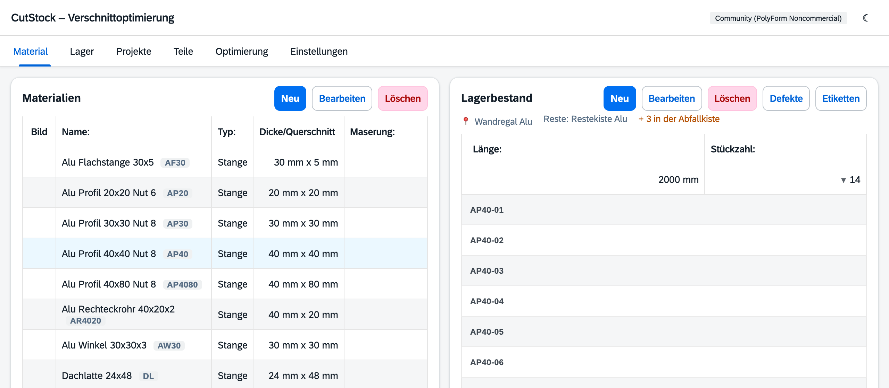

# Reiter „Material“

[← Handbuch](README.md)

Links stehen die Materialien, rechts der Lagerbestand des gewählten Materials.

## Materialien

**Neu** / **Bearbeiten** (oder Doppelklick) öffnet den Material-Dialog:

| Feld | Bedeutung |
|------|-----------|
| Name, Typ | Platte oder Stange |
| Dicke / Querschnitt | Platten: Dicke; Stangen: Breite × Tiefe |
| Maserung | nur Platten: keine, längs, quer – bestimmt, ob Teile gedreht werden dürfen |
| Besäumung | Rand, der vor dem Zuschnitt rundum abgeschnitten wird (beschädigte Kanten) |
| Min. Restlänge / -breite | Abschnitte ab diesem Maß sind **Reste** und kommen zurück ins Lager, kleinere sind Abfall |
| Kürzel | für die Stück-Codes, z. B. `AP40` → `AP40-07`; leer = Vorschlag aus dem Namen |
| Lagerort | wo das Material liegt (Pflicht); „+ Neuer Lagerort …“ legt direkt einen an |
| Lagerort für Reste | wo die Reste liegen; „(gleicher Ort)“ = beim Material |
| Bild | optional, erscheint als Miniatur und im PDF |

Mehr zu Lagerorten im Reiter [Lager](2-lager.md).

## Lagerbestand

Über dem Bestand steht, wo das Material liegt (📍), wo seine Reste liegen und ob etwas davon in
der Abfallkiste ist. Darunter je Maß eine Zeile mit Anzahl; Reste sind markiert.

- **Neu** bucht Stücke ein (Länge, bei Platten Breite, Stückzahl, „ist ein Rest“).
  Jedes Stück bekommt automatisch einen Code.
- **Bearbeiten** / **Löschen** ändert bzw. löscht eine Bestandszeile.
- **▶ Anzahl** klappt die einzelnen Stücke auf: Code, Notiz, Defekte und – mit 🔒 – für welches
  Projekt das Stück reserviert ist. **Doppelklick** auf ein Stück: Notiz ändern oder entnehmen.
- **Defekte** erfasst Astlöcher, Risse usw. je Stück; die Optimierung umgeht sie.
- **Etiketten …** öffnet die Auswahl, für welche Stücke ein Etikett gedruckt wird (Material, Maß,
  Lagerort und Code) – siehe [Etiketten drucken](2-lager.md#etiketten-drucken).

Frei gewordene Stücknummern werden erst nach einer Sperrfrist neu vergeben
(Einstellungen → Lager), falls ein Stück versehentlich ausgetragen wurde und noch im Regal liegt.
