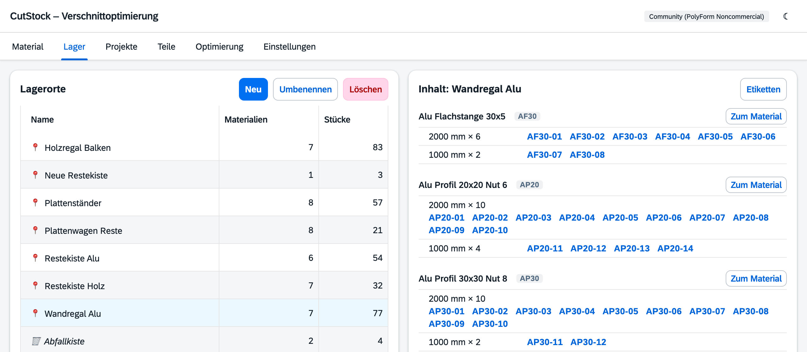

# Reiter „Lager“

[← Handbuch](README.md)

Der Reiter **Lager** beantwortet die Frage „Was liegt wo?“. Links stehen die Lagerorte,
rechts der Inhalt des gewählten Orts. Bestand anlegen und ändern geschieht weiter im
Reiter [Material](1-material.md) – hier geht es um die Orte und darum, was dort liegt.

## Lagerorte

Lagerorte sind eine feste Liste (Regal, Plattenwagen, Restekiste …). Jedes Material liegt an
genau **einem** Lagerort, alle seine Stücke liegen dort. Optional bekommt ein Material einen
eigenen **Ort für Reste** – beim Sägen entstandene Reste liegen in der Praxis oft woanders als
die vollen Längen (Stangen an der Wand, Reste in der Kiste darunter).

- **Neu** legt einen Lagerort an.
- **Umbenennen** (oder Doppelklick) ändert den Namen in einem Schritt – alle Materialien zeigen
  danach den neuen Namen.
- **Löschen**: Ein leerer Lagerort wird sofort gelöscht. Liegt dort noch Material, fragt CutStock,
  an welchen Ort es stattdessen soll. Der letzte Lagerort lässt sich nicht löschen.

Es gibt immer mindestens einen Lagerort; beim ersten Start legt CutStock „Lager“ an.

Welcher Lagerort zu einem Material gehört, stellt man im Material-Dialog ein (Reiter Material →
Bearbeiten → *Lagerort* und *Lagerort für Reste*). Dort gibt es auch **„+ Neuer Lagerort …“**,
um einen Ort direkt beim Anlegen eines Materials zu erstellen.

## Inhalt eines Lagerorts

Rechts stehen die Materialien am gewählten Ort, je Maß mit Anzahl und den Stück-Codes.
„nur Reste“ heißt: An diesem Ort liegen nur die Reste des Materials (sein Reste-Ort).
Mit 🔒 markierte Stücke sind von einem gespeicherten Plan reserviert.

- **Code anklicken** öffnet das Stück: Notiz ändern oder **Entnehmen …**
- **Zum Material** springt in den Reiter Material zu diesem Material.
- **Etiketten** druckt für jedes Stück an diesem Ort ein Etikett – praktisch, um ein Regal neu
  zu beschriften.

## Stück entnehmen

Wird ein Stück ohne Plan aus dem Lager genommen (verkauft, für etwas anderes verbraucht, defekt),
öffnet man es und wählt **Entnehmen …** mit einem Grund:

| Grund | Bedeutung |
|-------|-----------|
| Verbraucht | für etwas anderes verwendet |
| Verkauft / abgegeben | hat die Werkstatt verlassen |
| Defekt, entsorgt | unbrauchbar, weggeworfen |
| In die Abfallkiste | liegt jetzt ohne Code in der Abfallkiste (wenn eingeschaltet) |

Ist das Stück von einem Plan reserviert, weist CutStock darauf hin – der Mensch entscheidet.
Wird es trotzdem entnommen, zeigt der Plan danach „Nicht mehr im Lager: AP40-07 – ggf. neu
optimieren“.

Beim Sägen nach Plan muss man nichts entnehmen: Das Abhaken im Reiter
[Optimierung](5-optimierung.md) trägt das Stück aus und bucht Reste ein.

## Abfallkiste

Abschnitte, die kleiner als das Mindest-Restmaß des Materials sind, werden normalerweise
weggeworfen. Mit **Einstellungen → Lager → „Abfallstücke in der Abfallkiste aufheben“** führt
CutStock sie stattdessen in der Abfallkiste – zur Übersicht, falls einmal ein Projekt mit kleinen
Teilen kommt.

- **Untergrenze** („Abfall erst ab …“): Kleinere Abschnitte werden trotzdem weggeworfen.
  Bei Platten zählt die schmalere Seite.
- Abfall hat **keinen Code** und kein Etikett, nur Material, Maß und Anzahl. In der Werkstatt
  schreibt man die Länge einfach mit Stift aufs Stück.
- Die Optimierung verwendet die Abfallkiste **nicht**.
- Im Schnittplan und im PDF steht bei jedem Abschnitt, wohin er gehört: *zurück ins Lager*,
  *in die Abfallkiste* oder *wegwerfen*.
- **1 entnehmen** nimmt ein Stück aus der Kiste, **Wegwerfen** leert die Kiste für ein Material,
  **Kiste leeren** leert sie ganz.
- Im Reiter Material steht über dem Bestand „+ n in der Abfallkiste“, wenn dort etwas von diesem
  Material liegt.

Beim Ausschalten bleibt der Inhalt der Kiste erhalten; die Kiste wird angezeigt, solange etwas
darin liegt.

## Lagerjournal

Jede Lagerbuchung wird protokolliert – Zugang, Entnahme (mit Grund), gesägt nach Plan, Rest
eingebucht, Abfall, Änderungen an Lagerorten –, egal ob sie aus der Oberfläche oder per
[REST-API](api.md) kommt. Abrufbar ist das Journal derzeit über die API (`GET /api/journal`).
