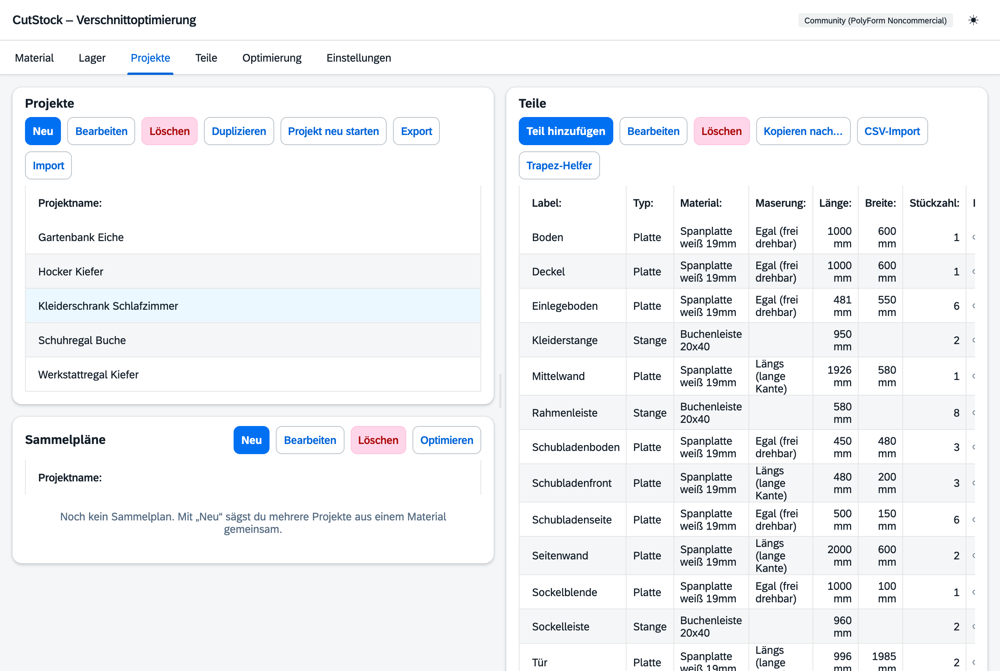
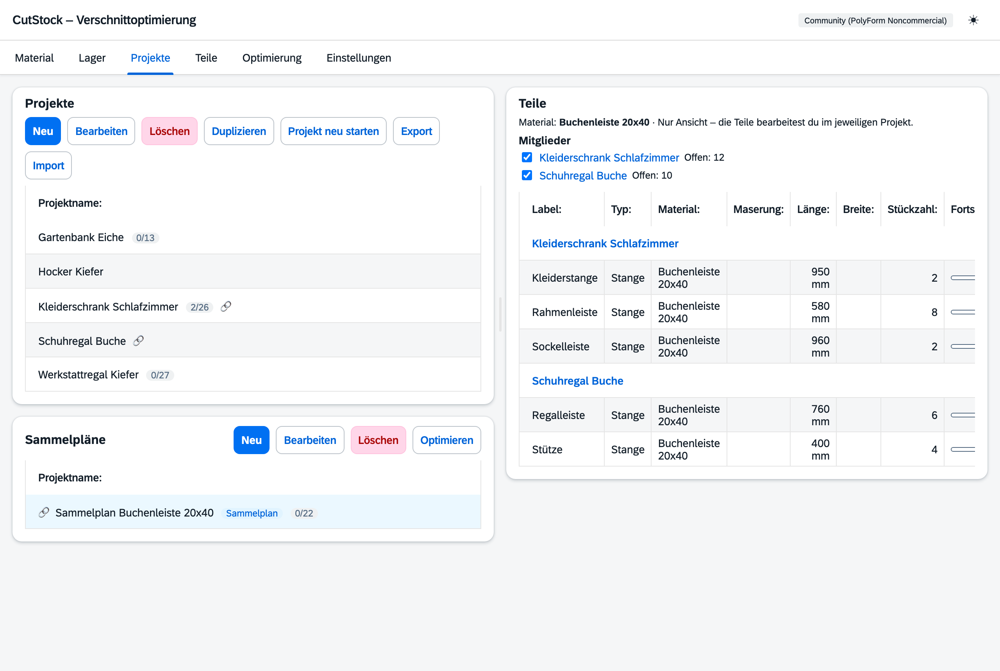

# Reiter „Projekte“

[← Handbuch](README.md)

Links oben die Projekte, darunter die Sammelpläne, rechts die Teile des gewählten Eintrags.

## Projekte

- **Neu**, **Bearbeiten**, **Löschen**, **Duplizieren** wie gewohnt.
- **Projekt neu starten**: um ein Projekt noch einmal zu sägen – der Fortschritt aller Teile geht
  auf 0, die gespeicherten Pläne werden gelöscht, das Lager bleibt unverändert (mit Rückfrage).
- **Als Vorlage speichern**: Wird das Projekt immer wieder gebaut, ist eine
  [Vorlage](4-teile.md#vorlagen) besser – jeder Durchgang bekommt seinen eigenen Sägeauftrag, das
  Projekt bleibt, wie es ist. Die Stückzahl gilt je Exemplar.
- **Anzahl Exemplare**: Wird ein Projekt mehrfach gebaut, genügt die Anzahl am Projekt –
  alle Exemplare werden gemeinsam optimiert.
- Import/Export als JSON, Teilelisten-Import aus CSV. Eine exportierte Vorlage wird beim Import
  wieder eine Vorlage.
- Ein kleines 🔗 markiert Projekte, die in einem Sammelplan stecken (der Tooltip nennt ihn).
  Sägeaufträge stehen nicht hier, sondern im Reiter [Teile](4-teile.md).

## Teile

Jedes Teil hat Label, Typ, Material, Maße, Stückzahl (je Exemplar) und Maserungsrichtung
(egal, längs, quer). Der Fortschritt zeigt, wie viele schon gesägt sind.

Im Dialog „Teil bearbeiten“ lassen sich die **Fertigteile** (Stück auf Vorrat) von Hand
korrigieren, etwa nach einer Inventur.

Teile, deren Material in einem Sammelplan gesägt wird, sind **grau** und tragen den Hinweis
„→“ mit dem Namen des Sammelplans; ein Klick darauf wählt den Sammelplan aus. Bearbeiten lassen sie sich trotzdem –
ein schon berechneter Sammelplan gilt danach als veraltet.

## Sammelpläne

Ein Sammelplan sägt die Teile mehrerer Projekte aus **einem Material** gemeinsam – das spart
oft ganze Stangen oder Platten. Je Material gibt es höchstens einen Sammelplan. Die Einträge im
Kasten „Sammelpläne“ tragen ein 🔗 und das Etikett „Sammelplan“.

- **Neu**: Material wählen, dann die Projekte mit offenen Teilen in diesem Material ankreuzen.
  Hat das Material schon einen Sammelplan, wird dieser geöffnet. Der Name lautet
  „Sammelplan“ plus Materialname, z. B. „Sammelplan Buchenleiste 20x40“.
- **Bearbeiten**: umbenennen.
- **Ausgewählt** zeigt der rechte Kasten die Mitglieder mit Häkchen (dort ändern) und darunter
  ihre Teile in diesem Material, nach Projekt gruppiert und nur zur Ansicht. Projektnamen sind
  Links ins jeweilige Projekt; bearbeitet wird dort.
- **Optimieren** springt in die [Optimierung](5-optimierung.md#sammelplan) und wählt dort diesen
  Sammelplan aus.
- **Sammelplan neu starten** (der Knopf „Projekt neu starten“ heißt bei ausgewähltem Sammelplan
  so): um ihn noch einmal zu sägen. In allen Mitgliedern geht der Fortschritt der Teile **dieses
  Materials** auf 0, Teile aus anderen Materialien bleiben, wie sie sind. Der gespeicherte
  Sammelplan wird gelöscht, das Lager bleibt unverändert – danach **Optimieren**, gerechnet wird
  mit dem aktuellen Lager samt Resten. Ist in den Projekten nichts mehr offen, bleibt ein fertig
  gesägter Plan beim Neu-Berechnen stehen, und CutStock weist auf diesen Knopf hin.
- **Löschen** wie ein Projekt, mit Warnung, wenn schon gesägt wurde. Nichts geht verloren:
  Gesägte Teile bleiben in ihren Projekten als gesägt, der Rest wird wieder offen, reservierte
  Lagerstücke werden frei. Danach lassen sich die Projekte einzeln optimieren oder neu
  zusammenfassen.
