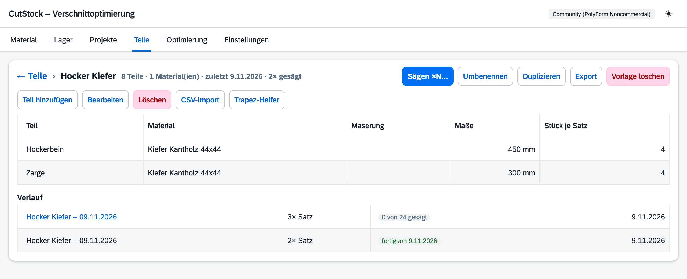

# Reiter „Teile“

[← Handbuch](README.md)

Der Reiter zeigt alles, was in deinen Projekten **noch gesägt werden muss** – sortiert nach
Material, weil immer ein Material auf einmal gesägt wird. Hier wählst du Teile aus verschiedenen
Projekten aus und sägst sie zusammen. Was du immer wieder sägst, hebst du als
[Vorlage](#vorlagen) auf.

## Offene Teile

- Oben steht, wie viele Stück in wie vielen Projekten noch offen sind.
- Je Material eine Gruppe (zum Auf- und Zuklappen) mit der Zahl der Teile und Stück und einer
  groben Lager-Schätzung: **Lager reicht** oder **Lager fehlt ca. n Stangen/Platten**. Die
  Schätzung rechnet nur über Länge bzw. Fläche; genau rechnet erst die Optimierung.
- Filter nach Material und Projekt. Fertige Teile sind ausgeblendet („auch fertige zeigen“).
- Der Projektname ist ein Link ins Projekt.

Unter dem Projektnamen steht, was mit dem Teil schon läuft:

- **im Sammelplan …** – das Material dieses Projekts wird im Sammelplan gesägt; das Teil lässt
  sich hier nicht auswählen. Ein Klick wählt den Sammelplan aus.
- **n im Sägeauftrag „…“** – so viele Stück sind schon beauftragt. In der Spalte „offen“ steht
  dann, wie viele noch frei sind.
- **n als Füllteil verplant** – liegt ungesägt im Plan eines anderen Projekts.
- **n Fertigteile · übernehmen** – siehe unten.

## Jetzt sägen

Teile anhaken – die Menge („sägen“) ist mit allem vorbelegt, was noch frei ist, und lässt sich
ändern. Unten erscheint eine Leiste mit der Auswahl:

- **Jetzt sägen →** legt einen **Sägeauftrag** an und springt direkt in die
  [Optimierung](5-optimierung.md), die ihn gleich berechnet.
- **In Reste von … mitsägen** nimmt die Teile als Füllteile in den Plan eines anderen Projekts
  mit (siehe [Optimierung → Füllteile](5-optimierung.md#füllteile)). Das geht nur mit Teilen
  aus einem Material.

Gesägte Teile zählen **direkt bei ihrem Projekt** als gesägt. Nur was über die offene Menge
hinaus gesägt wird, kommt zu den **Fertigteilen**.

## Sägeaufträge

Laufende Sägeaufträge stehen oben im Reiter, mit Fortschritt („3 von 5 gesägt“),
**Weitersägen** (öffnet die Optimierung), **Als Vorlage speichern** und **Löschen**. Bereits
Gesägtes bleibt beim Löschen bei den Projekten verbucht. Ist ein Auftrag komplett gesägt, bietet
CutStock an, ihn zu löschen – vorher lässt er sich mit einem Häkchen als Vorlage aufheben, damit
du ihn später wiederholen kannst. In der Optimierung stehen Sägeaufträge in der Arbeitsliste in
einer eigenen Gruppe, im Reiter Projekte nicht.

## Vorlagen

Eine **Vorlage** ist eine feste Stückliste, die du immer wieder sägst – etwa „Regal Typ A“ oder
ein Schubkastenset. Sie wird nie selbst gesägt und hat keinen Fortschritt. Mit **Sägen ×N…**
entsteht daraus jedes Mal ein neuer Sägeauftrag, berechnet mit dem Lager von heute.

So entsteht eine Vorlage:

- aus einem Sägeauftrag: **Als Vorlage speichern** in seiner Zeile oder im Dialog, wenn er fertig
  gesägt ist. Der Projektname hinter den Teilen („Seite (Regal)“) fällt dabei weg, solange die
  Namen eindeutig bleiben.
- neu: **Neue Vorlage**, dann Teile anlegen oder eine CSV-Datei importieren,
- aus einem Projekt: **Als Vorlage speichern** im Reiter [Projekte](3-projekte.md) – die
  Stückzahl gilt je Exemplar,
- aus einer Datei: **Import** liest eine exportierte Vorlage (oder ein Projekt) als Vorlage ein.

Im Kasten **Vorlagen** steht je Vorlage, wie viele Teile und Materialien sie hat, wann sie zuletzt
gesägt wurde und wie oft. **Sägen ×N…** fragt nach der Zahl der **Sätze** (wie oft die ganze
Stückliste gesägt wird) und optional nach einem Namen – sonst heißt der Auftrag „Vorlage – Datum“.
Eine Vorschau zeigt, wie viele Teile aus welchen Materialien entstehen; läuft schon ein
Durchgang, steht er als Hinweis dabei. **Anlegen und sägen →** springt in die
[Optimierung](5-optimierung.md) und berechnet den Auftrag gleich.

Ein Durchgang ist ein ganz normaler Sägeauftrag mit dem Hinweis „aus Vorlage …“. Seine Teile
zählen nur bei ihm selbst als gesägt – auch beim zweiten und dritten Mal landet nichts bei den
Fertigteilen eines anderen Teils.

**Bearbeiten** öffnet die Vorlage im Reiter (zurück mit „← Teile“):

- Teile **neu**, **bearbeiten**, **entfernen**, **CSV-Import** und **Trapez-Helfer** wie im Reiter
  Projekte; die Stückzahl heißt hier „Stück je Satz“.
- **Umbenennen**, **Duplizieren**, **Export** (JSON-Datei) und **Vorlage löschen**. Schon
  angelegte Sägeaufträge bleiben beim Löschen erhalten.
- **Verlauf**: jeder Durchgang mit Sätzen, Stand („8 von 24 gesägt“, „fertig am …“) und Datum.
  Laufende Durchgänge sind Links in die Optimierung. Wird ein Sägeauftrag gelöscht, bleibt sein
  Eintrag mit dem letzten Stand stehen.

Änderungen an der Vorlage gelten ab dem nächsten Durchgang; laufende Sägeaufträge bleiben, wie sie
sind. Wird ein Material gelöscht, verschwinden seine Teile auch aus den Vorlagen – die Rückfrage
nennt die betroffenen Vorlagen.

## Fertigteile

Fertig gesägte Teile auf Vorrat, die noch keinem Projekt angerechnet sind – etwa weil mehr
gesägt wurde, als offen war. Ist beim Teil wieder etwas offen, übernimmt **übernehmen** sie als
gesägt (hier oder im Plan in der Optimierung). Von Hand korrigieren lassen sie sich im Dialog
„Teil bearbeiten“ (Reiter Projekte).
