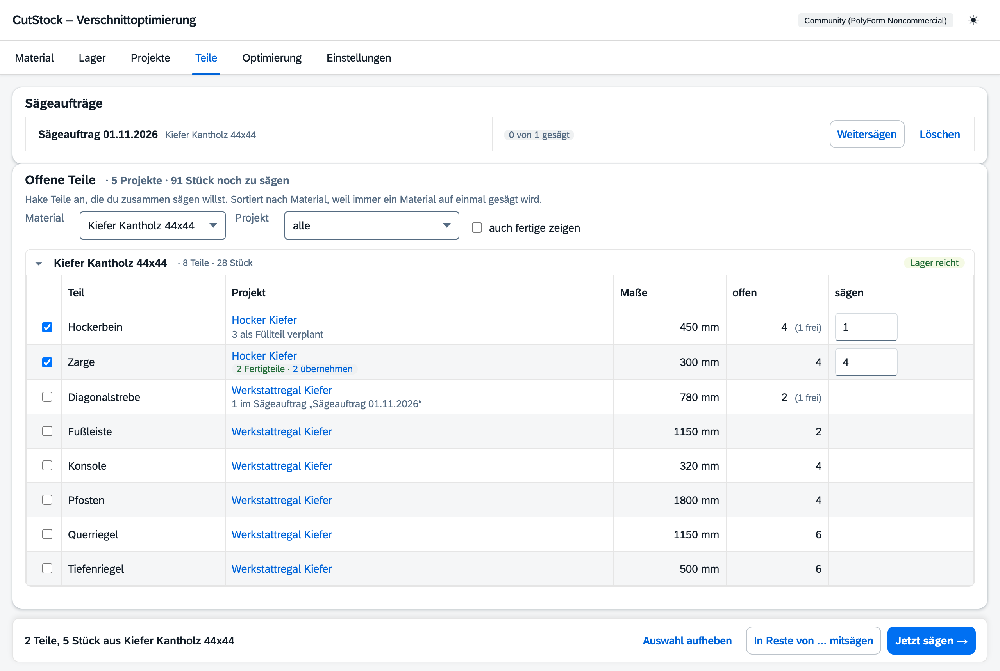

# Reiter „Teile“

[← Handbuch](README.md)

Der Reiter zeigt alles, was in deinen Projekten **noch gesägt werden muss** – sortiert nach
Material, weil immer ein Material auf einmal gesägt wird. Hier wählst du Teile aus verschiedenen
Projekten aus und sägst sie zusammen.

## Offene Teile

- Oben steht, wie viele Stück in wie vielen Projekten noch offen sind.
- Je Material eine Gruppe (zum Auf- und Zuklappen) mit der Zahl der Teile und Stück und einer
  groben Lager-Schätzung: **Lager reicht** oder **Lager fehlt ca. n Stangen/Platten**. Die
  Schätzung rechnet nur über Länge bzw. Fläche; genau rechnet erst die Optimierung.
- Filter nach Material und Projekt. Fertige Teile sind ausgeblendet („auch fertige zeigen“).
- Der Projektname ist ein Link ins Projekt.

Unter dem Projektnamen steht, was mit dem Teil schon läuft:

- **im Sammelplan …** – das Material dieses Projekts wird im Sammelplan gesägt; das Teil lässt
  sich hier nicht auswählen. Ein Klick wählt den Sammelplan aus.
- **n im Sägeauftrag „…“** – so viele Stück sind schon beauftragt. In der Spalte „offen“ steht
  dann, wie viele noch frei sind.
- **n als Füllteil verplant** – liegt ungesägt im Plan eines anderen Projekts.
- **n Fertigteile · übernehmen** – siehe unten.

## Jetzt sägen

Teile anhaken – die Menge („sägen“) ist mit allem vorbelegt, was noch frei ist, und lässt sich
ändern. Unten erscheint eine Leiste mit der Auswahl:

- **Jetzt sägen →** legt einen **Sägeauftrag** an und springt direkt in die
  [Optimierung](5-optimierung.md), die ihn gleich berechnet.
- **In Reste von … mitsägen** nimmt die Teile als Füllteile in den Plan eines anderen Projekts
  mit (siehe [Optimierung → Füllteile](5-optimierung.md#füllteile)). Das geht nur mit Teilen
  aus einem Material.

Gesägte Teile zählen **direkt bei ihrem Projekt** als gesägt. Nur was über die offene Menge
hinaus gesägt wird, kommt zu den **Fertigteilen**.

## Sägeaufträge

Laufende Sägeaufträge stehen oben im Reiter, mit Fortschritt („3 von 5 gesägt“),
**Weitersägen** (öffnet die Optimierung) und **Löschen**. Bereits Gesägtes bleibt beim Löschen
bei den Projekten verbucht. Ist ein Auftrag komplett gesägt, bietet CutStock an, ihn zu löschen.
In der Optimierung stehen Sägeaufträge in der Arbeitsliste in einer eigenen Gruppe, im Reiter
Projekte nicht.

## Fertigteile

Fertig gesägte Teile auf Vorrat, die noch keinem Projekt angerechnet sind – etwa weil mehr
gesägt wurde, als offen war. Ist beim Teil wieder etwas offen, übernimmt **übernehmen** sie als
gesägt (hier oder im Plan in der Optimierung). Von Hand korrigieren lassen sie sich im Dialog
„Teil bearbeiten“ (Reiter Projekte).
