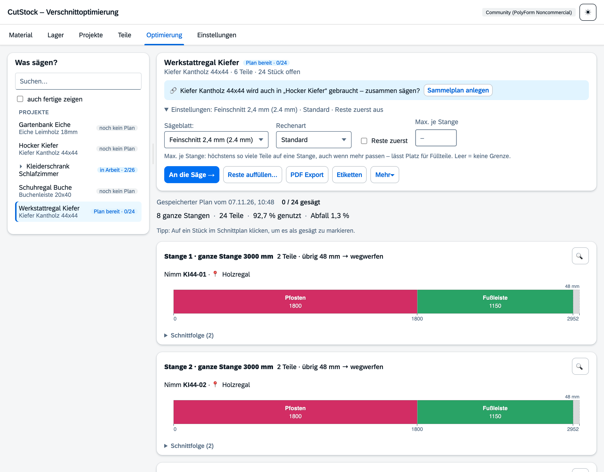
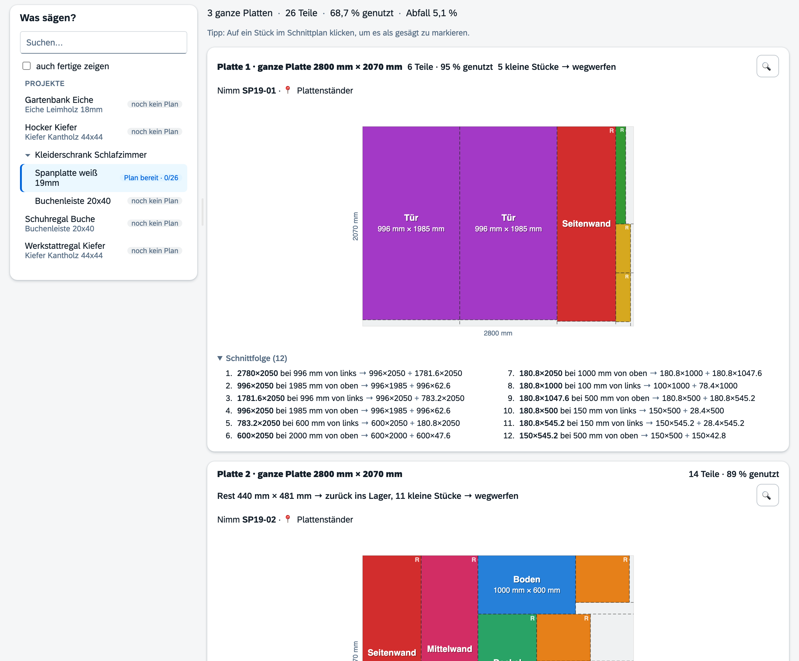
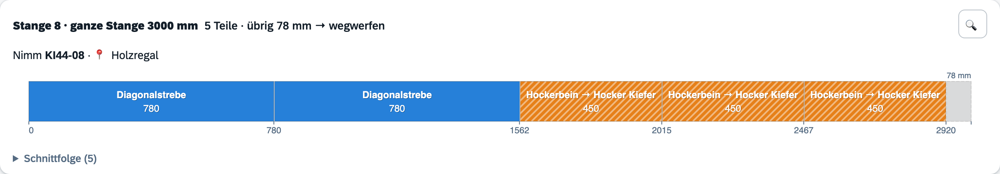
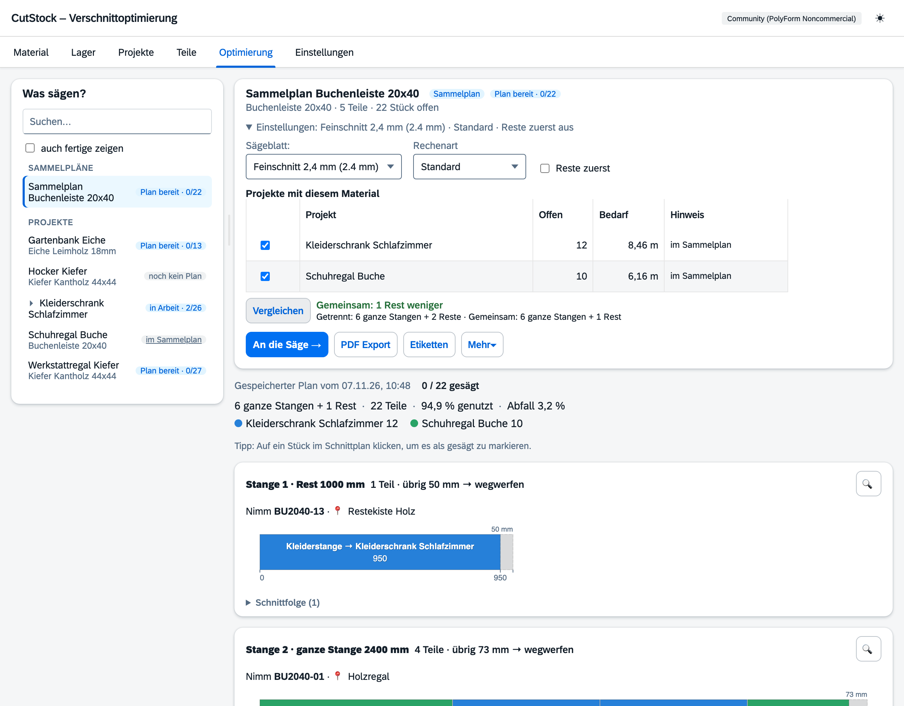
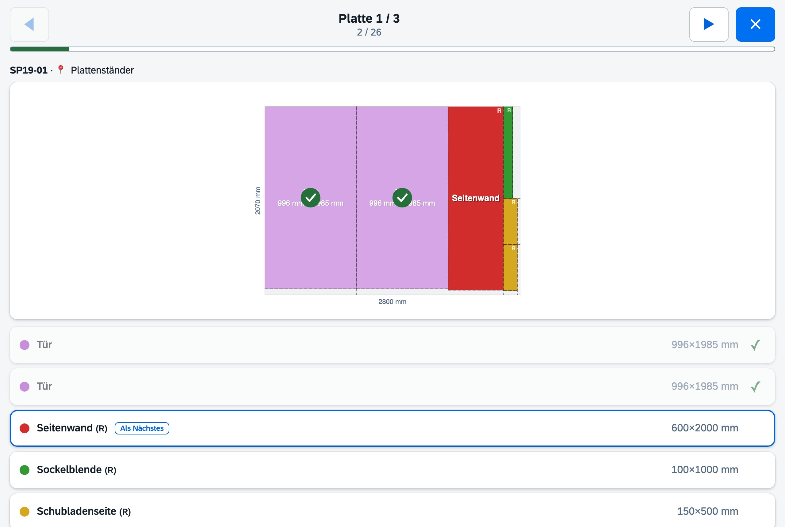

# Reiter „Optimierung“

[← Handbuch](README.md)

Hier entstehen die Schnittpläne – und hier wird beim Sägen abgehakt.

## Was sägen? – die Arbeitsliste

Links steht alles, was gesägt werden kann, in drei Gruppen:

- **Sammelpläne** – je ein Eintrag (siehe [Sammelplan](#sammelplan)),
- **Sägeaufträge** – aus dem Reiter [Teile](4-teile.md#sägeaufträge),
- **Projekte** – mit mehreren Materialien aufklappbar, darunter eine Zeile je Material.

Jede Zeile zeigt ihren Stand:

| Stand | Bedeutung |
|---|---|
| noch kein Plan | Es gibt offene Teile, aber noch keinen Schnittplan |
| Plan bereit · 0/12 | Plan berechnet, noch nichts gesägt (gesägt/Stücke im Plan) |
| in Arbeit · 5/12 | Es wird gerade gesägt |
| Plan veraltet | Teile oder Material wurden geändert, oder Teile wurden inzwischen anderswo gesägt |
| im Sammelplan | Dieses Material wird im Sammelplan gesägt – ein Klick öffnet ihn |
| im Sägeauftrag … | Alle offenen Teile stecken schon in diesem Sägeauftrag – ein Klick öffnet ihn (bei mehreren: „in 3 Sägeaufträgen“, die Namen stehen im Tooltip) |
| anderswo verplant | Alle offenen Teile stecken schon in einem anderen Plan (z. B. als Füllteile) |
| fertig | Alles gesägt (nur mit „auch fertige zeigen“) |

Oben lässt sich nach Namen oder Material suchen. Die Breite der Liste lässt sich am Griff zwischen
Liste und Plan ziehen und wird gemerkt. Die Auswahl bleibt erhalten, auch beim Wechsel der Reiter. Sprünge aus anderen Reitern („Jetzt sägen →“, „Weitersägen“, „Optimieren“ beim
Sammelplan) wählen den passenden Eintrag hier aus.

## Rechts: Stand und eine Hauptaktion

Rechts oben stehen Name, Material, offene Teile und Stück. Darunter steht immer nur **eine** blaue
Hauptaktion, passend zum Stand:

| Stand | Hauptaktion |
|---|---|
| noch kein Plan | **Schnittplan berechnen** |
| Plan bereit / in Arbeit | **An die Säge →** (öffnet den [Werkstatt-Modus](#werkstatt-modus)) |
| Plan veraltet | **Neu berechnen** – der Grund steht über dem Plan |
| fertig | keine – nur noch PDF und Etiketten |

Daneben: **Reste auffüllen…** (siehe [Füllteile](#füllteile)), **PDF Export**, **Etiketten**
und das Menü **Mehr** mit *Neu berechnen*, *Alles als gesägt markieren…* (mit Rückfrage) und
*Plan verwerfen* (gibt reservierte Stücke frei).

**Projekt neu starten** (Fortschritt auf 0, Pläne weg, Lager bleibt) steht im Reiter
[Projekte](3-projekte.md).

Wird das Material des gewählten Projekts auch in anderen Projekten gebraucht und gibt es noch
keinen Sammelplan, erscheint der Hinweis „… wird auch in ‚X‘ gebraucht – zusammen sägen?“.
**Sammelplan anlegen** legt ihn mit diesen Projekten an und wählt ihn aus.

### Einstellungen

Wählt man einen Eintrag, sind die Einstellungen aufgeklappt; zugeklappt fasst eine Zeile sie
zusammen, z. B. „Alu-Kappsäge 2,8 mm · Standard · Reste zuerst aus“:

- **Sägeblatt** – vorgewählt ist das Sägeblatt des Materials (siehe
  [Material](1-material.md)). Wer mit einem anderen rechnet, macht es damit zum neuen Standard
  dieses Materials.
- **Rechenart** – bei Stangen **Standard** oder **Gründlich**, bei Platten **Schnell**,
  **Standard** (Guillotine mit intelligenter Schnittrichtung) oder **Gründlich** (genetischer
  Algorithmus, dauert länger).
- **Reste zuerst** – erst nur Reste verplanen, dann ganze Stangen/Platten.
- **Max. je Stange** – legt fest, wie viele Teile höchstens auf eine Stange kommen, auch wenn mehr
  draufpassen würden. Leer („–“) heißt keine Grenze. Beispiel: Bei 2 bleibt am Ende jeder Stange
  Platz, den **Reste auffüllen…** mit Teilen anderer Projekte füllen kann (siehe
  [Füllteile](#füllteile)). Gibt es nur für Stangen, nicht für Platten.

Jede Berechnung wird als **Plan** gespeichert. Der Plan reserviert seine noch nicht angefangenen
Stücke, andere Projekte verplanen sie nicht (abschaltbar unter Einstellungen → Lager).
Hinweise erscheinen, wenn sich Teile oder Material seit der Berechnung geändert haben oder ein
eingeplantes Stück nicht mehr im Lager ist (mit Code, z. B. „Nicht mehr im Lager: AP40-07“).

### Kennzahlen

Eine Zeile über dem Plan: „6 ganze Stangen + 2 Reste · 24 Teile · 95 % genutzt · Abfall 2 %“.
Reicht das Material nicht, steht darunter ein roter Kasten mit den Teilen, die nicht gesägt werden
können, und der Einkaufsliste (siehe [Materialbedarf](#materialbedarf)).

## Der Plan

Jede Stange/Platte hat eine Kopfzeile: was man in die Hand nimmt („Nimm AP40-07 ·
Wandregal Alu“), wie viele Teile darauf liegen und **wohin jeder Abschnitt gehört**:

- **zurück ins Lager** – ab dem Mindest-Restmaß; der größte Rest behält den Code des Bretts,
  er liegt danach am Reste-Ort des Materials,
- **in die Abfallkiste** – kleiner, aber über der Untergrenze, wenn die Abfallkiste eingeschaltet ist
  (siehe [Lager](2-lager.md#abfallkiste)),
- **wegwerfen** – alles andere.

Ein Klick auf ein Teil im Plan hakt es als gesägt ab. Beim ersten Teil eines Bretts wird das
Stück aus dem Lager ausgetragen, Reste werden eingebucht, Abfall kommt in die Abfallkiste.
Zurücknehmen macht das wieder rückgängig.

Stangen sind im Plan **im gleichen Maßstab** gezeichnet: Die längste füllt die Breite, kürzere
sind entsprechend kürzer. Sehr kurze Stangen werden etwas breiter gezeichnet und dann gestrichelt
umrandet. Die Lupe und der Werkstatt-Modus zeigen jede Stange in voller Breite.

## Platten

2D-Guillotine-Packing: Alle Schnitte gehen von Kante zu Kante, so dass Reste Rechtecke bleiben.
Die nummerierte Schnittfolge unter jedem Plan sagt genau, wo gesägt wird – die Sägeblattbreite
ist eingerechnet.

## Füllteile

Bleibt am Ende einer Stange oder auf einer Platte Abfall, füllt CutStock ihn mit Teilen aus
anderen Projekten auf (**Reste auffüllen…**). Es wird nie mehr Material verbraucht. Füllteile sind
schraffiert, tragen ihr Herkunftsprojekt und zählen gesägt direkt bei ihrem Projekt (Überzähliges kommt zu den Fertigteilen).

## Sammelplan

Wird dasselbe Material in mehreren Projekten gebraucht, sägt ein Sammelplan sie gemeinsam. Er
steht oben in der Arbeitsliste; gewählt zeigt er seine Projekte mit Häkchen. **Vergleichen** zeigt
die Ersparnis gegenüber getrennten Plänen, **Schnittplan berechnen** rechnet die angehakten
Projekte zusammen. Jedes Projekt bekommt eine eigene Farbe; abgehakte Teile zählen in ihrem
Projekt. Anlegen, umbenennen, Mitglieder ändern und löschen geht auch im Reiter
[Projekte](3-projekte.md#sammelpläne), Kasten „Sammelpläne“.

## Materialbedarf

Reicht der Bestand nicht, steht im roten Kasten „Material reicht nicht – 2 Teile können nicht
gesägt werden: …“ mit den betroffenen Teilen und darunter **Nachkaufen**, z. B. „2× 6000 mm“
(in der Größe des größten Stücks im Lager). **Ins Lager** bucht das direkt als Bestand ein.

Ist ein Teil länger als jede Stange (bzw. größer als jede Platte) im Lager, steht es in einer
eigenen Zeile „Länger als jede Stange im Lager: …“ – mehr Stangen derselben Länge helfen dort
nicht, es braucht längeres Material. Solche Teile zählen nicht zur Einkaufsliste.

## Werkstatt-Modus

**An die Säge →** öffnet das Vollbild fürs Tablet an der Säge: eine Stange/Platte pro Seite mit Stück-Code und Lagerort,
große Touch-Ziele, Fortschritt, „Als Nächstes“-Markierung. Entstandene Reste werden mit ihrem
Code angezeigt und können gleich als Etikett gedruckt werden.

## PDF

Teileliste mit Anzahl, Materialbedarf mit Stück-Codes und Lagerort, gleiche Schnittmuster
zusammengefasst; bei jedem Muster steht, wohin die Abschnitte gehören. Sprache und Maßeinheit
richten sich nach den [Einstellungen](6-einstellungen.md).
