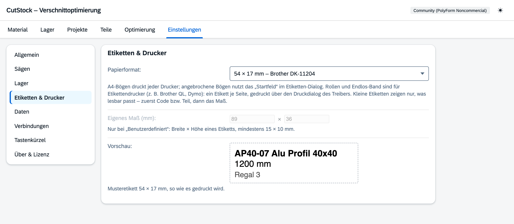

# Reiter „Einstellungen“

[← Handbuch](README.md)

Links stehen die Gruppen, rechts die Einstellungen der gewählten Gruppe. Unter jeder Einstellung
steht in einer Zeile, was sie bewirkt. Einstellungen, die von einer anderen abhängen, sind
ausgegraut, solange diese aus ist (z. B. „Abfall erst ab“ ohne Abfallkiste). Geändert wird sofort,
ohne Speichern-Knopf.

| Gruppe | Einstellungen |
|---------|---------------|
| Allgemein | Sprache (Deutsch, English, Français, Italiano), Maßeinheit (mm/cm), Farbschema (Auto, hell, dunkel) |
| Sägen | Sägeblätter mit Name und Schnittbreite; welches ein Material nimmt, steht am [Material](1-material.md) |
| Lager | **Pläne reservieren ihr Material** – eingeplante Stücke werden von anderen Projekten nicht verplant |
| | **Nummern-Sperrfrist** – frei gewordene Stücknummern erst nach so vielen Tagen neu vergeben (0 = sofort) |
| | **Abfallstücke in der Abfallkiste aufheben** – Abschnitte unter dem Mindest-Restmaß kommen in die [Abfallkiste](2-lager.md#abfallkiste) statt in den Müll |
| | **Abfall erst ab …** – kleinere Abschnitte werden trotzdem weggeworfen (Platten: schmalere Seite) |
| Etiketten & Drucker | Format (siehe unten), eigenes Maß, Vorschau |
| Daten | Backup erstellen bzw. wiederherstellen (alle Daten als ZIP) |
| Verbindungen | REST-API: aktivieren, Port, API-Key (siehe [REST-API](api.md)) |
| Tastenkürzel | Taste anklicken, neue Taste drücken |
| Über & Lizenz | Version, Nach Updates suchen, Lizenzstatus und Lizenzschlüssel |

Feste Tasten: **1–6** wechseln die Reiter, **Enter** speichert einen Dialog, **Esc** schließt ihn.

## Etiketten-Formate

| Gruppe | Formate |
|---|---|
| A4-Bögen | 70 × 36 mm (Avery 3475, 24 je Bogen), 63,5 × 38,1 mm (Avery L7160, 21), 99,1 × 38,1 mm (Avery L7163, 14) |
| A4-Bögen, kleine Etiketten | 38,1 × 21,2 mm (Avery L7651, 65), 25,4 × 10 mm (Avery L7658, 189) |
| Rollen | 62 × 29 mm (Brother DK-11209), 90 × 38 mm (DK-11208), 100 × 62 mm (DK-11202), 89 × 36 mm (Dymo 99012), 90 × 29 mm (DK-11201) |
| Rollen, kleine Etiketten | 54 × 17 mm (Brother DK-11204), 23 × 23 mm (DK-11221), 51 × 19 mm (Dymo 11355), 25 × 13 mm (Dymo 11353) |
| Endlos-Band | 12, 29 und 62 mm breit (Brother DK-22214, DK-22210, DK-22205) – die Länge richtet sich nach dem Inhalt |
| Benutzerdefiniert | eigenes Maß, mindestens 15 × 10 mm |

A4-Bögen druckt jeder Drucker. Rollen und Endlos-Band sind für Etikettendrucker wie Brother QL oder
Dymo: Das PDF hat je Etikett eine Seite in Etikettengröße, gedruckt wird über den Druckdialog mit
dem Treiber des Druckers.

**Kleine Etiketten** zeigen nur, was lesbar passt, in dieser Reihenfolge: Stück-Code bzw. Teil,
Maß, Material/Lagerort. Code und Maß werden nie abgeschnitten. Auf sehr flachen Etiketten bleibt
eine Zeile, z. B. „AP40-07 · 1200 mm“. Die **Vorschau** zeigt ein Musteretikett genau so, wie es
gedruckt wird.
