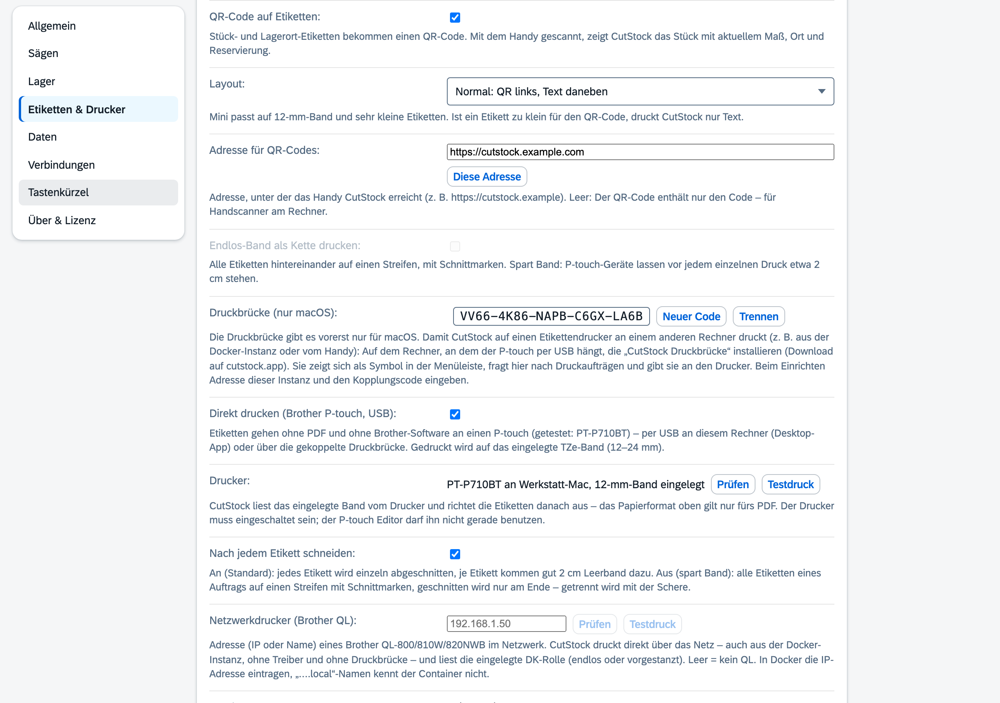

# Reiter „Einstellungen“

[← Handbuch](README.md)

Links stehen die Gruppen, rechts die Einstellungen der gewählten Gruppe. Unter jeder Einstellung
steht in einer Zeile, was sie bewirkt. Einstellungen, die von einer anderen abhängen, sind
ausgegraut, solange diese aus ist (z. B. „Abfall erst ab“ ohne Abfallkiste). Geändert wird sofort,
ohne Speichern-Knopf.

| Gruppe | Einstellungen |
|---------|---------------|
| Allgemein | Sprache (Deutsch, English, Français, Italiano), Maßeinheit (mm, cm, Zoll dezimal, Zoll als Bruch), Farbschema (Auto, hell, dunkel) |
| | **Zoll als Bruch** – auf 1/16" gerundet, ab 12" wahlweise in Fuß und Zoll (`2' 1/4"`). Eingabe auch als `1 3/4`, `1-3/4"`, `2' 1/4"` oder `8ft`. Gespeichert wird immer in Millimetern |
| Sägen | Sägeblätter mit Name und Schnittbreite; welches ein Material nimmt, steht am [Material](1-material.md) |
| Lager | **Pläne reservieren ihr Material** – eingeplante Stücke werden von anderen Projekten nicht verplant |
| | **Nummern-Sperrfrist** – frei gewordene Stücknummern erst nach so vielen Tagen neu vergeben (0 = sofort) |
| | **Abfallstücke in der Abfallkiste aufheben** – Abschnitte unter dem Mindest-Restmaß kommen in die [Abfallkiste](2-lager.md#abfallkiste) statt in den Müll |
| | **Abfall erst ab …** – kleinere Abschnitte werden trotzdem weggeworfen (Platten: schmalere Seite) |
| Etiketten & Drucker | Format (siehe unten), eigenes Maß, [QR-Code und Layout](#qr-codes), Adresse für QR-Codes, Kettendruck, [Direkt drucken](#direkt-drucken-brother-p-touch), Vorschau |
| Daten | Backup erstellen bzw. wiederherstellen (alle Daten als ZIP) |
| Verbindungen | REST-API: aktivieren, Port, API-Key (siehe [REST-API](api.md)) |
| Tastenkürzel | Taste anklicken, neue Taste drücken |
| Über & Lizenz | Version, Nach Updates suchen, Lizenzstatus und Lizenzschlüssel |

Feste Tasten: **1–6** wechseln die Reiter, **Enter** speichert einen Dialog, **Esc** schließt ihn.

## Etiketten-Formate

| Gruppe | Formate |
|---|---|
| A4-Bögen | 70 × 36 mm (Avery 3475, 24 je Bogen), 63,5 × 38,1 mm (Avery L7160, 21), 99,1 × 38,1 mm (Avery L7163, 14) |
| A4-Bögen, kleine Etiketten | 38,1 × 21,2 mm (Avery L7651, 65), 25,4 × 10 mm (Avery L7658, 189) |
| Rollen | 62 × 29 mm (Brother DK-11209), 90 × 38 mm (DK-11208), 100 × 62 mm (DK-11202), 89 × 36 mm (Dymo 99012), 90 × 29 mm (DK-11201) |
| Rollen, kleine Etiketten | 54 × 17 mm (Brother DK-11204), 23 × 23 mm (DK-11221), 51 × 19 mm (Dymo 11355), 25 × 13 mm (Dymo 11353) |
| Endlos-Band | 12, 29 und 62 mm breit (Brother DK-22214, DK-22210, DK-22205) – die Länge richtet sich nach dem Inhalt |
| P-touch-Band (TZe) | 12, 18 und 24 mm (z. B. Brother PT-P710BT) – laminiert, hält Öl und Abrieb aus; bedruckt wird nur die Höhe, die der Druckkopf erreicht (9,9 / 15,8 / 18,1 mm) |
| Benutzerdefiniert | eigenes Maß, mindestens 15 × 10 mm |

A4-Bögen druckt jeder Drucker. Rollen und Endlos-Band sind für Etikettendrucker wie Brother QL oder
Dymo: Das PDF hat je Etikett eine Seite in Etikettengröße, gedruckt wird über den Druckdialog mit
dem Treiber des Druckers.

**Kleine Etiketten** zeigen nur, was lesbar passt, in dieser Reihenfolge: Stück-Code bzw. Teil,
Maß, Material/Lagerort. Code und Maß werden nie abgeschnitten. Auf sehr flachen Etiketten bleibt
eine Zeile, z. B. „AP40-07 · 1200 mm“. Die **Vorschau** zeigt ein Musteretikett genau so, wie es
gedruckt wird.

**Endlos-Band als Kette drucken:** Alle Etiketten kommen hintereinander auf einen Streifen (bis
40 cm, dann der nächste) mit gestrichelten Schnittmarken. Das spart Band, denn P-touch-Geräte
lassen vor jedem einzelnen Druck etwa 2 cm stehen.

## Direkt drucken (Brother P-touch und QL)

Für den **Brother PT-P710BT** (P-touch Cube Plus) gibt es am Mac keinen Druckertreiber, nur
Brothers eigene Apps. CutStock steuert den Drucker deshalb selbst an – ohne PDF und ohne
Brother-Software:

1. Drucker per **USB** an den Mac anschließen und einschalten, TZe-Band 12, 18 oder 24 mm einlegen.
2. In der **Desktop-App** unter Einstellungen → Etiketten & Drucker **Direkt drucken** einschalten.
   Darunter steht der gefundene Drucker mit dem eingelegten Band („PT-P710BT, 12-mm-Band
   eingelegt“); **Testdruck** druckt das Musteretikett.
   Vor jedem Druck fragt CutStock nach und zeigt, wie viele Etiketten es werden und wie viel Band
   das ungefähr braucht („3 Etiketten auf 12-mm-Band, ca. 21 cm Band“).
3. Ab jetzt gehen alle Etiketten (Etiketten-Dialog, Etikett eines Stücks, Ortsetiketten, Reste
   nach dem Sägen, Scan-Ansicht) an den Drucker. Im Etiketten-Dialog gibt es daneben **Als PDF**.

CutStock liest das eingelegte Band vom Drucker und richtet die Etiketten danach aus; das
Papierformat gilt dann nur fürs PDF, die Vorschau zeigt das Band.

**Band sparen:** Zwischen Druckkopf und Messer liegen etwa 2,5 cm – so viel Leerband kommt vor
jedem geschnittenen Stück mit heraus. Standardmäßig schneidet CutStock **nach jedem Etikett**.
Schaltest du **Nach jedem Etikett schneiden** aus, kommen alle Etiketten eines Auftrags auf
**einen Streifen** mit gestrichelten Schnittmarken, geschnitten wird nur am Ende – das spart je
Etikett gut 2 cm Band, getrennt wird mit der Schere. Für kleine Teile reicht
12-mm-Band mit dem Layout „Mini“ – das ist das günstigste Band.

Meldet der Drucker etwas (kein Band, Deckel offen, Band zu schmal, Drucker belegt – etwa weil der
P-touch Editor ihn gerade nutzt), zeigt CutStock es an.

#### Brother QL im Netzwerk (z. B. QL-820NWB)

Einen **Brother QL-800/810W/820NWB** im Netzwerk spricht CutStock direkt an – auch aus der
Docker-Instanz, ohne Treiber und ohne Druckbrücke:

1. Unter Einstellungen → Etiketten & Drucker bei **Netzwerkdrucker (Brother QL)** die Adresse
   eintragen, am besten die **IP-Adresse** (z. B. `192.168.1.50`; die Docker-Instanz kennt
   „….local“-Namen nicht). **Prüfen** zeigt dann z. B. „QL-820NWB, 29 mm endlos eingelegt“.
2. **Direkt drucken** einschalten.

CutStock liest die eingelegte **DK-Rolle** selbst: Endlosrollen (12–62 mm, Länge aus dem Inhalt)
und vorgestanzte Etiketten (z. B. 29 × 90 mm, 62 × 29 mm). Für die **Rot/Schwarz-Rolle**
(DK-22251, 62 mm) das Häkchen **Rot/Schwarz-Rolle eingelegt** setzen – der QL meldet das übers Netz
nicht. Rot gedruckt wird die fette Titelzeile (Code und Material bzw. der Lagerort).

Sind P-touch und QL eingerichtet, bestimmt **Standarddrucker** die Vorauswahl; in der Rückfrage vor
jedem Druck lässt sich der andere wählen. Der QL meldet über IPP, wann ein Auftrag fertig ist;
Fehler wie „Deckel offen“ oder „keine Rolle“ zeigt CutStock an.

#### Druckbrücke (nur macOS): aus der Docker-Instanz und vom Handy drucken

> Die Druckbrücke gibt es vorerst **nur für macOS**. Unter Windows bleibt das PDF.

Läuft CutStock als Docker-Instanz auf einem Server, hängt der Drucker meist an einem anderen
Rechner. Dafür gibt es die **CutStock Druckbrücke**: ein kleines Programm für den Mac, an dem der
P-touch per USB hängt. Sie zeigt sich als Drucker-Symbol in der Menüleiste, fragt bei deiner
Instanz nach Druckaufträgen und gibt sie an den Drucker. Gedruckt werden kann dann aus jedem
Browser (auch Safari) und vom Handy, etwa aus der Scan-Ansicht.

1. In CutStock unter Einstellungen → Etiketten & Drucker bei **Druckbrücke** auf **Koppeln**
   klicken. CutStock zeigt einen **Kopplungscode** (z. B. `323E-M2M8-TYCS-2PHY-P4B6`).
2. Die Druckbrücke von cutstock.app laden und auf dem Mac mit dem Drucker starten. Beim ersten
   Start fragt sie nach der **Adresse** deiner Instanz und dem **Kopplungscode** und trägt sich
   als Anmeldeobjekt ein (startet also künftig von selbst; im Menü abschaltbar).
3. **Direkt drucken** einschalten. Darunter steht dann z. B. „PT-P710BT an Werkstatt-Mac,
   12-mm-Band eingelegt“.

Im Menü der Brücke: Status (bereit, druckt, kein Drucker, keine Verbindung), **Pausieren**,
**CutStock öffnen**, **Einrichten …**, **Beim Anmelden starten**, **Beenden**.

Zum Schutz vor verschwendetem Band: Holt die Brücke einen Auftrag nicht innerhalb einer Minute
ab (Rechner aus, Brücke pausiert), verfällt er – es wird nicht später nachgedruckt. Ein Auftrag
wird nie doppelt gedruckt. Vor jedem Druck prüft die Brücke das eingelegte Band. Der Rechner mit
dem Drucker muss an und angemeldet sein; im Ruhezustand druckt er nicht. **Neuer Code** macht den
alten Kopplungscode ungültig, **Trennen** schaltet die Brücke ab.

## QR-Codes

| Einstellung | Bedeutung |
|---|---|
| QR-Code auf Etiketten | Stück- und Lagerort-Etiketten bekommen einen QR-Code (Standard: an). Teile-Etiketten aus dem Schnittplan haben keinen. |
| Layout | **Normal** – QR links, Text daneben · **Mini** – QR und Code (mit Maß, wenn Platz ist), für kleine Teile und 12-mm-Band · **Nur QR** – Code klein darunter (z. B. 23 × 23 mm) |
| Adresse für QR-Codes | Adresse, unter der das Handy CutStock erreicht, z. B. `https://cutstock.example`. **Diese Adresse** übernimmt die aktuelle. Leer: nur der Code im QR-Code (für Handscanner) |

Der QR-Code ist mindestens 7 mm groß. Passt er nicht aufs Etikett, druckt CutStock nur Text und die
Vorschau sagt das. Wie man scannt, steht unter [Lager → QR-Codes scannen](2-lager.md#qr-codes-scannen).
