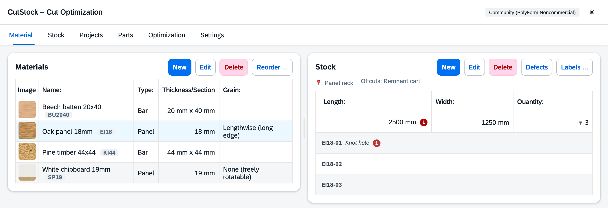

# "Material" tab

[← Manual](README.md)

On the left are the materials, on the right the stock of the selected material.

## Materials

**New** / **Edit** (or double-click) opens the material dialog:

| Field | Meaning |
|-------|---------|
| Name, type | panel or bar |
| Thickness / cross-section | panels: thickness; bars: width × depth |
| Grain | panels only: none, lengthwise, crosswise – decides whether parts may be rotated |
| Trim | margin cut off all around before cutting (damaged edges) |
| Min. remnant length / width | pieces from this size on are **offcuts** and go back to stock, smaller ones are scrap |
| Short code | for piece codes, e.g. `AP40` → `AP40-07`; empty = suggestion from the name |
| Storage location | where the material is stored (required); "+ New location …" creates one right away |
| Storage location for remnants | where its offcuts are stored; "(same location)" = with the material |
| Saw blade | preselected in [Optimization](5-optimization.md#settings); empty = first saw blade. Calculating there with a different one makes it the new default |
| Image | optional, shown as thumbnail and in the PDF |

More about locations in the [Stock](2-stock.md) tab.

## Stock

Above the stock you see where the material is stored (📍), where its offcuts are and whether some
of it is in the offcut bin. Below that, one row per size with quantity; offcuts are marked.

- **New** adds pieces (length, width for panels, quantity, "is an offcut").
  Every piece gets a code automatically.
- **Edit** / **Delete** changes or removes a stock row.
- **▶ quantity** expands the individual pieces: code, note, defects and – with 🔒 – which project
  the piece is reserved for. **Double-click** a piece to change its note or take it out.
- **Defects** records knots, cracks etc. per piece; optimization routes around them.
- **Labels …** lets you choose which pieces get a label (material, size, location and code) –
  see [Printing labels](2-stock.md#printing-labels).

Freed piece numbers are only reused after a lock period (Settings → Stock), in case a piece was
deducted by mistake and is still on the rack.
