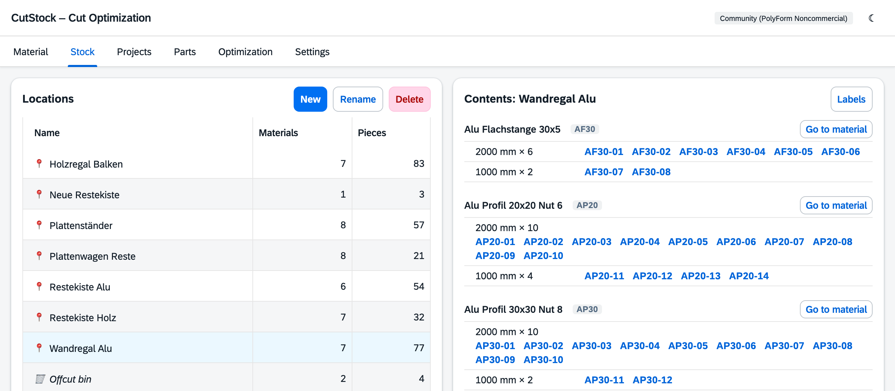
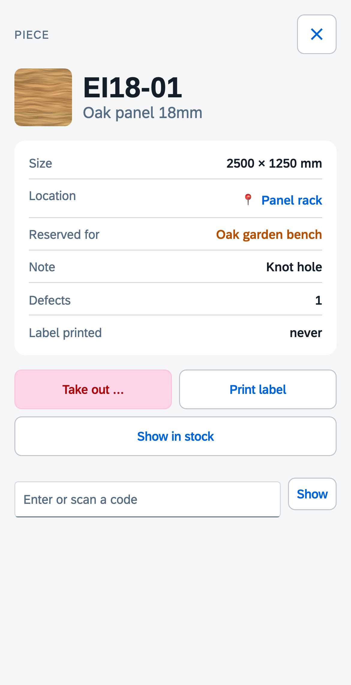

# "Stock" tab

[← Manual](README.md)

The **Stock** tab answers the question "What is where?". On the left are the storage locations,
on the right the contents of the selected location. Adding and changing stock still happens in
the [Material](1-material.md) tab – this tab is about the locations and what is stored there.

## Locations

Locations are a fixed list (rack, panel cart, offcut box …). Every material is stored at exactly
**one** location, and all its pieces are there. Optionally a material gets its own **location for
offcuts** – in practice, offcuts from sawing are often kept somewhere else than full lengths
(bars on the wall, offcuts in the box below).

- **New** creates a location.
- **Rename** (or double-click) changes the name in one step – all materials show the new name.
- **Delete**: an empty location is deleted right away. If material is still stored there,
  CutStock asks where it should go instead. The last location cannot be deleted.

There is always at least one location; on first start CutStock creates "Stock".

Which location belongs to a material is set in the material dialog (Material tab → Edit →
*Storage location* and *Storage location for remnants*). It also offers **"+ New location …"** to create a location
right while creating a material.

## Contents of a location

On the right are the materials at the selected location, per size with quantity and piece codes.
"offcuts only" means only the offcuts of that material are stored here (its offcut location).
Pieces marked 🔒 are reserved by a saved plan.

- **Click a code** to open the piece: change its note, **Print label** or **Take out …**
- **Go to material** jumps to that material in the Material tab.
- **Labels …** prints labels for pieces at this location (see below), optionally together with
  the label for the location itself.
- **Location labels** (left) prints the labels of all locations, e.g. to relabel a rack.

## Printing labels

**Labels …** (here and in the Material tab) lists all pieces by material and size, each with a
checkbox. A checkbox on a material or size selects every piece below it.

- Preselected are the pieces that have **never had a label printed** (marked "new") – typically
  after a delivery or after cutting. If there are none, everything is preselected.
- Quick selection: **All**, **None**, **Not printed yet**, **Offcuts only**, **Whole pieces only**.
- **Start at field** (A4 sheets only): on a partly used sheet, printing starts at the given field
  (1 = top left, then row by row).
- The button shows the count, e.g. **Print 5**. Printed pieces then count as labelled.
- The format (A4 sheet, roll for label printers, also very small labels) is set under
  [Settings → Labels & printer](6-settings.md#label-formats).

A single label, e.g. to replace one that fell off, is printed with **Print label** in the piece's
dialog, which also shows when a label was last printed. Pieces that were already in stock before
this feature count as labelled.

In the label dialog of a location there is also **Label for the location "…"** at the top: the
location label shows the name in large type, the materials below it, and a QR code to the location.

## Scanning QR codes

Piece and location labels carry a **QR code** (can be switched off under
[Settings → Labels & printer](6-settings.md#qr-codes)). Scanned with a phone camera, CutStock
opens in the browser – no app needed:

- **Piece:** code, material, **current size** (also after cutting – the largest offcut keeps the
  code), location, reservation, note and defects. Buttons: **Take out …**, **Print label**,
  **Show in stock**. Tap the location to open it.
- **Location:** all materials with their pieces at this location; tap a piece to open it.
- **Not found:** the piece is no longer in stock; CutStock shows the last entry, e.g.
  "taken out on 11/9/2026".

The phone must be able to reach CutStock (workshop Wi-Fi) and *Address for QR codes* must contain
the instance's address. Without an address the QR code only holds the code (`AP40-07`, for
locations `O:3`) – which suits a **hand scanner** at the computer: it types the code into the
**Code / scan…** field at the top right, Enter opens the same view. Codes can be typed there too.

If you change a material's short code, CutStock remembers the old one: labels with `AP40-07`
still find the piece, the new code is shown.

## Taking a piece out

If a piece leaves stock without a plan (sold, used for something else, defective), open it and
choose **Take out …** with a reason:

| Reason | Meaning |
|--------|---------|
| Used | used for something else |
| Sold / given away | has left the workshop |
| Defective, disposed of | unusable, thrown away |
| Into the offcut bin | now kept without a code in the offcut bin (if switched on) |

If the piece is reserved by a plan, CutStock tells you – the person decides. If it is taken out
anyway, the plan then shows "No longer in stock: AP40-07 – consider optimizing again".

When sawing by plan you don't need to take anything out: ticking pieces off in the
[Optimization](5-optimization.md) tab deducts the piece and books the offcuts.

## Offcut bin

Pieces smaller than the material's minimum remnant size are normally thrown away. With
**Settings → Stock → "Keep offcuts in the offcut bin"** CutStock keeps them in the offcut bin
instead – as an overview, in case a project with small parts comes along.

- **Lower limit** ("Only offcuts from …"): smaller pieces are still thrown away.
  For panels the narrower side counts.
- Scrap has **no code** and no label, only material, size and quantity. In the workshop you simply
  write the length on the piece.
- Optimization does **not** use the offcut bin.
- The cut plan and the PDF say for every offcut where it goes: *back to stock*,
  *into the offcut bin* or *throw away*.
- **Take 1** takes one piece out of the bin, **Throw away** empties it for one material,
  **Empty bin** empties it completely.
- In the Material tab, "+ n in the offcut bin" is shown above the stock if there is something of
  that material in the bin.

Switching it off keeps the contents; the bin is shown as long as something is in it.

## Stock journal

Every stock booking is recorded – receiving, taking out (with reason), sawn by plan, offcut booked,
scrap, changes to locations – no matter whether it comes from the interface or via the
[REST API](api.md). The journal is currently available via the API (`GET /api/journal`).
