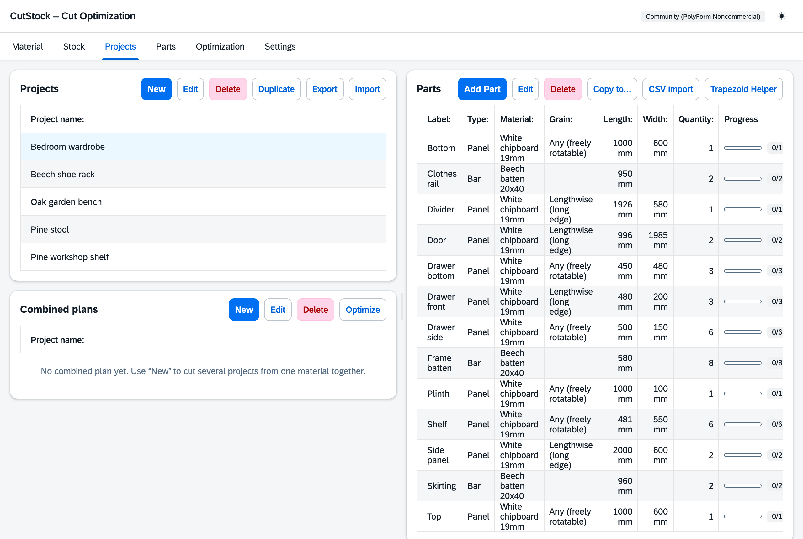

# "Projects" tab

[← Manual](README.md)

On the left the projects, on the right the parts of the selected project.

## Projects

- **New**, **Edit**, **Delete**, **Duplicate** as usual.
- **Number of copies**: if a project is built several times, set the number on the project –
  all copies are optimized together.
- Import/export as JSON, import part lists from CSV.
- A "Combined plan" badge marks projects that are part of a joint plan
  (see [Optimization](5-optimization.md#combined-plan)); "Cut list" marks lists created in the
  [Parts](4-parts.md) tab.

## Parts

Every part has a label, type, material, dimensions, quantity (per copy) and grain direction
(any, lengthwise, crosswise). The progress shows how many have already been cut.

In the "Edit part" dialog the **shelf stock** can be corrected by hand ("On the shelf"),
e.g. after a stocktaking.
