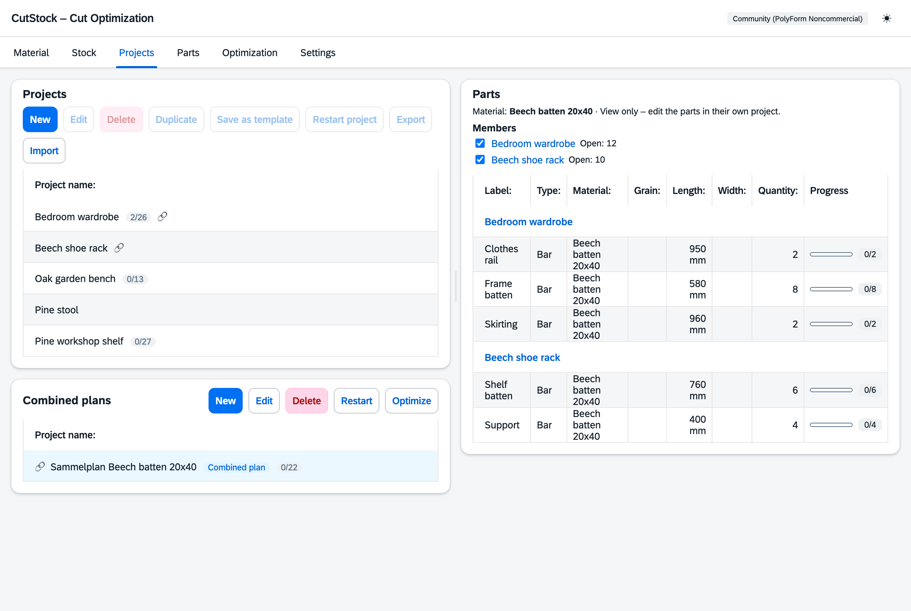

# "Projects" tab

[← Manual](README.md)

Top left the projects, below them the combined plans, on the right the parts of the selected entry.

## Projects

- **New**, **Edit**, **Delete**, **Duplicate** as usual.
- **Restart project**: to cut a project once more – progress of all parts goes back to 0, saved
  plans are deleted, stock stays unchanged (asks first).
- **Save as template**: if the project is built again and again, a
  [template](4-parts.md#templates) works better – every run gets its own cut job and the project
  stays as it is. Quantities are per copy.
- **Number of copies**: if a project is built several times, set the number on the project –
  all copies are optimized together.
- Import/export as JSON, import part lists from CSV. An exported template becomes a template again
  when imported.
- A small 🔗 marks projects that are part of a combined plan (the tooltip names it).
  Cut jobs are not listed here but in the [Parts](4-parts.md) tab.

## Parts

Every part has a label, type, material, dimensions, quantity (per copy) and grain direction
(any, lengthwise, crosswise). The progress shows how many have already been cut.

In the "Edit part" dialog the **finished parts** (pieces in stock) can be corrected by hand,
e.g. after a stocktaking.

Parts whose material is cut in a combined plan are **grey** and show "→" with the name of the combined plan;
clicking it selects the combined plan. They can still be edited – a combined plan that has
already been calculated is then marked as outdated.

## Combined plans

A combined plan cuts the parts of several projects from **one material** together – this often
saves whole bars or panels. There is at most one combined plan per material. The entries in the
"Combined plans" box carry a 🔗 and the label "Combined plan".

- **New**: choose the material, then tick the projects with open parts in this material. If the
  material already has a combined plan, that one is opened. It is named
  "Sammelplan" plus the material name, e.g. "Sammelplan Beech batten 20x40".
- **Edit**: rename.
- **When selected**, the right box shows the members with checkboxes (change them there) and
  below their parts in this material, grouped by project and read-only. Project names link to
  the project; parts are edited there.
- **Optimize** jumps to [Optimization](5-optimization.md#combined-plan) and selects this combined
  plan there.
- **Restart**: to cut the combined plan once more. In all members, progress of the parts made of **this material**
  goes back to 0; parts of other materials stay as they are. The saved combined plan is deleted,
  stock stays unchanged – then **Optimize**, calculated with the current stock including remnants.
  If nothing is open in the projects any more, a fully cut plan stays when you recalculate, and
  CutStock points you to this button.
- While a combined plan is selected, only **New** and **Import** are active in the "Projects" box
  above; the other buttons apply to projects and are greyed out.
- **Delete** like a project, with a warning if cutting has already started. Nothing is lost:
  parts already cut stay cut in their projects, the rest becomes open again and reserved stock
  pieces are released. Afterwards the projects can be optimized individually or combined anew.
