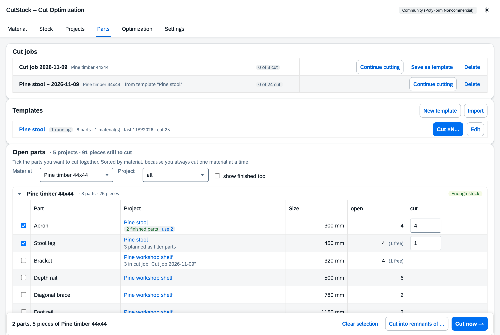
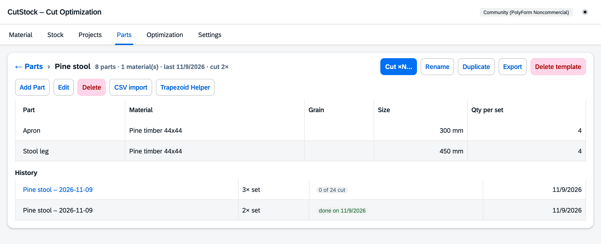

# "Parts" tab

[← Manual](README.md)

This tab shows everything your projects **still need to have cut** – sorted by material, because
you always cut one material at a time. Here you pick parts from different projects and cut them
together. Anything you cut again and again is kept as a [template](#templates).

## Open parts

- The top line shows how many pieces in how many projects are still open.
- One group per material (expand/collapse) with the number of parts and pieces and a rough stock
  estimate: **Enough stock** or **About n bars/panels short**. The estimate only adds up length or
  area; the optimization gives the exact answer.
- Filter by material and project. Finished parts are hidden ("show finished too").
- The project name links to the project.

Below the project name you see what is already happening with the part:

- **in combined plan …** – this project's material is cut in a combined plan; the part can't be
  selected here. A click selects the combined plan.
- **n in cut job "…"** – that many pieces are already in a cut job. The "open" column then shows
  how many are still free.
- **n planned as filler parts** – lies uncut in another project's plan.
- **n finished parts · use** – see below.

## Cut now

Tick parts – the quantity ("cut") is preset to everything still free and can be changed. A bar
with the selection appears at the bottom:

- **Cut now →** creates a **cut job** and jumps straight to the
  [Optimization](5-optimization.md), which calculates it right away.
- **Cut into remnants of …** takes the parts along as filler parts in another project's plan
  (see [Optimization → Filler parts](5-optimization.md#filler-parts)). This only works with parts
  of one material.

Cut parts count **directly for their own project**. Only what is cut beyond the open quantity
goes to the **finished parts**.

## Cut jobs

Running cut jobs are listed at the top of the tab with their progress ("3 of 5 cut"),
**Continue cutting** (opens the optimization), **Save as template** and **Delete**. Anything already
cut stays booked to the projects when a job is deleted. Once a job is fully cut, CutStock offers to
delete it – a tick box lets you keep it as a template first, so you can repeat it later. In the
optimization, cut jobs have their own group in the work list; they don't appear in the Projects tab.

## Templates

A **template** is a fixed parts list you cut again and again – say "Shelf type A" or a set of
drawers. It is never cut itself and has no progress. **Cut ×N…** turns it into a new cut job each
time, calculated with today's stock.

Ways to create a template:

- from a cut job: **Save as template** in its row, or in the dialog when it is fully cut. The
  project name after the parts ("Side (Shelf)") is dropped as long as the names stay unique.
- from scratch: **New template**, then add parts or import a CSV file,
- from a project: **Save as template** in the [Projects](3-projects.md) tab – quantities are per
  copy,
- from a file: **Import** reads an exported template (or a project) as a template.

The **Templates** box shows, per template, how many parts and materials it has, when it was last cut
and how often. **Cut ×N…** asks for the number of **sets** (how many times the whole parts list is
cut) and optionally a name – otherwise the job is called "Template – date". A preview shows how many
parts from which materials you will get; if a run is already in progress, it is mentioned.
**Create and cut →** jumps to the [Optimization](5-optimization.md) and calculates the job right
away.

A run is a regular cut job marked "from template …". Its parts only count as cut for the job
itself – even the second and third time nothing ends up in another part's finished parts.

**Edit** opens the template in the tab (back with "← Parts"):

- **New**, **Edit**, **Delete** parts, **CSV import** and **Trapezoid helper** as in the Projects
  tab; the quantity is called "Qty per set" here.
- **Rename**, **Duplicate**, **Export** (JSON file) and **Delete template**. Cut jobs already
  created are kept.
- **History**: every run with sets, status ("8 of 24 cut", "done on …") and date. Running runs link
  to the optimization. If a cut job is deleted, its entry stays with the last status.

Changes to the template apply from the next run; running cut jobs stay as they are. If a material is
deleted, its parts also disappear from templates – the confirmation names the templates affected.

## Finished parts

Finished parts in stock that no project has counted yet – e.g. because more was cut than was
open. Once the part has open pieces again, **use** counts them as cut (here or in the plan in the
Optimization tab). They can be corrected by hand in the "Edit part" dialog (Projects tab).
