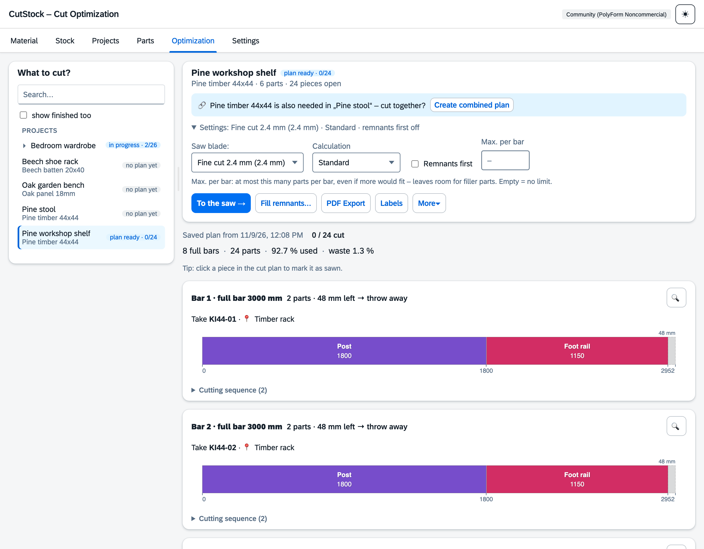
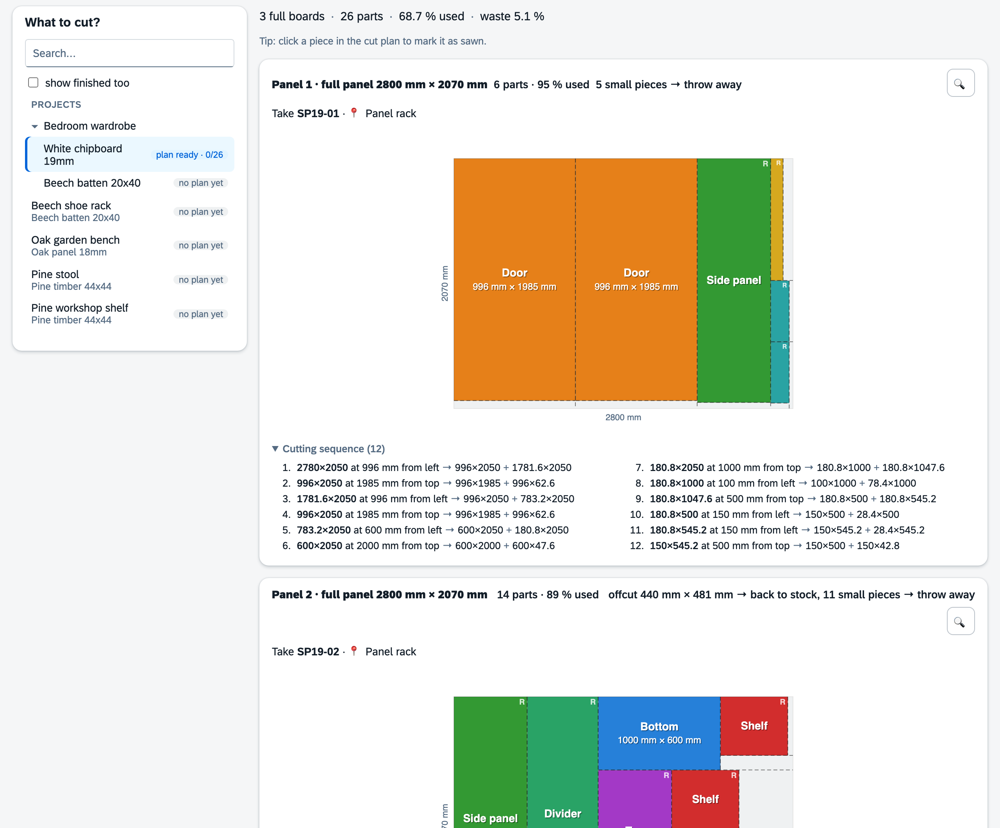
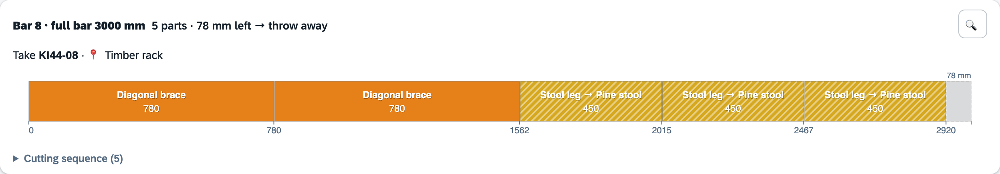
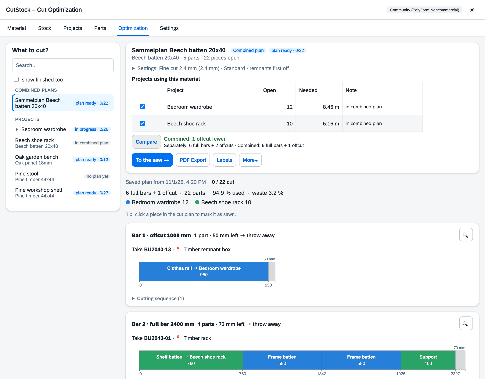
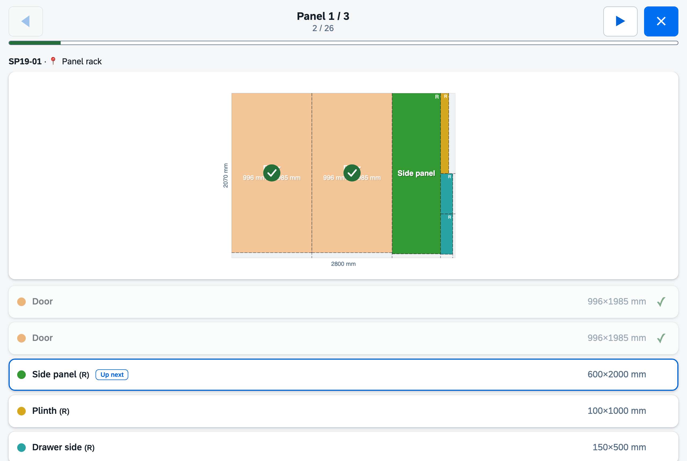

# "Optimization" tab

[← Manual](README.md)

This is where cut plans are made – and where pieces are ticked off while sawing.

## Optimize

Choose project, material, saw blade and algorithm, then **Optimize**.

- Algorithms: **Fast** (greedy), **Nested Guillotine** (smart split direction),
  **Thorough** (genetic algorithm).
- **Remnants first**: plan offcuts first, then full bars/panels.
- **Max. per bar**: at most this many parts per bar – leaves room for filler parts.

Every calculation is saved as a **plan**. The plan reserves its pieces that haven't been started
yet, so other projects don't plan them (can be switched off under Settings → Stock).
Notices appear when parts or material changed since the calculation, or when a planned piece is no
longer in stock (with its code, e.g. "No longer in stock: AP40-07").

## The plan

Every bar/panel has a header line: what to take ("Take AP40-07 · Rack Alu"), how many parts are on
it and **where every offcut goes**:

- **back to stock** – from the minimum remnant size on; the largest offcut keeps the board's code
  and is then stored at the material's offcut location,
- **into the offcut bin** – smaller, but above the lower limit, if the offcut bin is switched on
  (see [Stock](2-stock.md#offcut-bin)),
- **throw away** – everything else.

Clicking a part in the plan ticks it off as cut. With the first part of a board, the piece is
deducted from stock, offcuts are booked and scrap goes into the offcut bin. Unticking reverts it.

More buttons: **Confirm (cut)** for everything, **PDF export**, **Labels**, **Workshop mode**,
**Discard plan** (releases reserved pieces), **Restart project** (progress back to 0, stock stays).

## Panels

2D guillotine packing: every cut goes from edge to edge, so offcuts remain rectangles. The
numbered cutting sequence below each plan says exactly where to saw – the saw blade width is
already included.

## Filler parts

If there is waste at the end of a bar or on a panel, CutStock fills it with parts from other
projects (**Filler parts …**). It never uses more material. Filler parts are hatched, carry their
project and go onto their project's shelf once cut.

## Combined plan

If the same material is needed in several projects: "Optimize by: **Material (combined plan)**",
choose the material, tick the projects. **Compare** shows the savings against separate plans.
Every project gets its own color; ticked-off parts count in their project.

## Material requirements

If the stock isn't enough, CutStock shows a shopping list; one click adds it to stock.

## Workshop mode

Full screen for a tablet at the saw: one bar/panel per page with piece code and location, big
touch targets, progress, "next" marker. New offcuts are shown with their code and can be printed
as labels right away.

## PDF

Parts list with quantities, material requirements with piece codes and location, identical cutting
patterns combined; every pattern says where its offcuts go.
