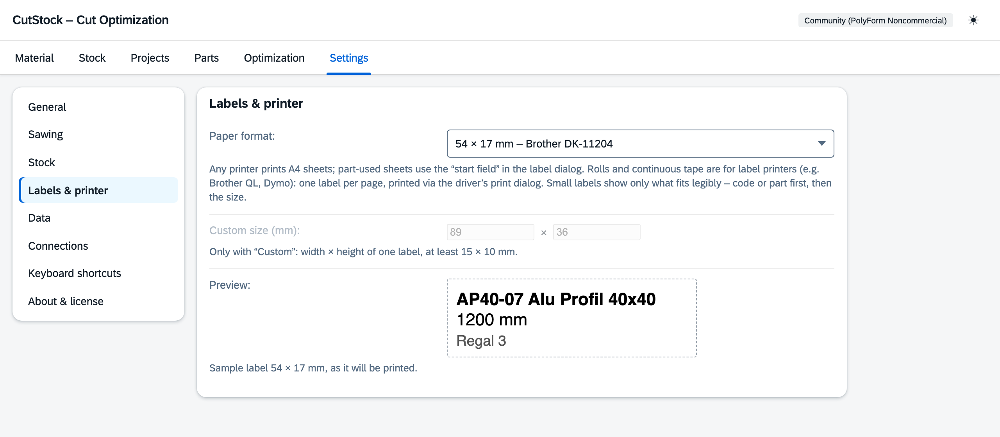

# "Settings" tab

[← Manual](README.md)

The groups are on the left, the settings of the selected group on the right. Below every setting
one line explains what it does. Settings that depend on another one are greyed out while that one
is off (e.g. "Only offcuts from" without the offcut bin). Changes apply immediately, there is no
save button.

| Group | Settings |
|---------|---------------|
| General | Language (Deutsch, English, Français, Italiano), unit (mm/cm), colour scheme (auto, light, dark) |
| Sawing | Saw blades with name and kerf; which one a material uses is set on the [material](1-material.md) |
| Stock | **Saved plans reserve their material** – planned pieces are not planned by other projects |
| | **Number lock period** – freed piece numbers are reused only after this many days (0 = right away) |
| | **Keep offcuts in the offcut bin** – sections below the minimum remnant size go into the [offcut bin](2-stock.md#offcut-bin) instead of the bin |
| | **Only offcuts from …** – smaller sections are still thrown away (panels: narrower side) |
| Labels & printer | Format (see below), custom size, preview |
| Data | Create or restore a backup (all data as ZIP) |
| Connections | REST API: enable, port, API key (see [REST API](api.md)) |
| Keyboard shortcuts | Click a key, press the new key |
| About & license | Version, check for updates, license status and license key |

Fixed keys: **1–6** switch tabs, **Enter** saves a dialog, **Esc** closes it.

## Label formats

| Group | Formats |
|---|---|
| A4 sheets | 70 × 36 mm (Avery 3475, 24 per sheet), 63.5 × 38.1 mm (Avery L7160, 21), 99.1 × 38.1 mm (Avery L7163, 14) |
| A4 sheets, small labels | 38.1 × 21.2 mm (Avery L7651, 65), 25.4 × 10 mm (Avery L7658, 189) |
| Rolls | 62 × 29 mm (Brother DK-11209), 90 × 38 mm (DK-11208), 100 × 62 mm (DK-11202), 89 × 36 mm (Dymo 99012), 90 × 29 mm (DK-11201) |
| Rolls, small labels | 54 × 17 mm (Brother DK-11204), 23 × 23 mm (DK-11221), 51 × 19 mm (Dymo 11355), 25 × 13 mm (Dymo 11353) |
| Continuous tape | 12, 29 and 62 mm wide (Brother DK-22214, DK-22210, DK-22205) – the length follows the content |
| Custom | your own size, at least 15 × 10 mm |

Any printer prints A4 sheets. Rolls and continuous tape are for label printers such as Brother QL or
Dymo: the PDF has one page per label in label size, printed via the print dialog with the
printer's driver.

**Small labels** show only what fits legibly, in this order: piece code or part, size,
material/location. Code and size are never cut off. On very flat labels one line remains, e.g.
"AP40-07 · 1200 mm". The **preview** shows a sample label exactly as it will be printed.
